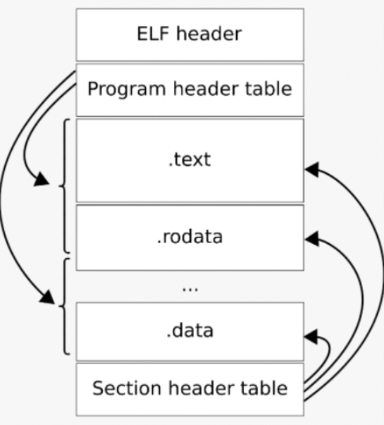
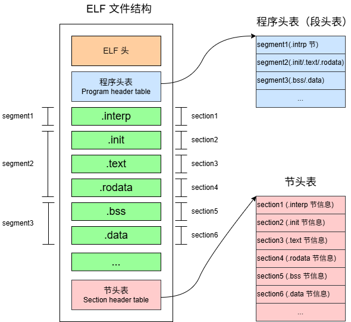

# 基于RISC-V的编译链接和装载02之ELF格式简介

[TOC]

在Windows和Linux操作系统上，可执行文件的格式是不同的：

* Windows 上的可执行文件格式：PE (Portable Executable)
* Linux 上的可执行文件格式：ELF (Executable and Linkable Format)

它们都是COFF (Common file format)格式的变种。这个系列文章只讲述Linux ELF格式。

以下进行简单介绍。

## 1 ELF的基本结构

ELF 全称为 Executable and Linkable Format，顾名思义，ELF格式主要用于链接和执行。

ELF基本结构如下图所示（图来自于参考2，维基百科），简单来说，ELF由如下几个部分组成：

* ELF头（ELF header）
* 节头表（Section header table）
* 程序头表 (也成段头表) （Program header table）
* 节（.text节，.data节，.bss节等）

其中节是实际内容，而ELF头用来管理整个ELF，节头表和程序头表都是用来管理节的，只是不同的管理方式。

### 1.1 ELF的两种视图：链接视图和执行视图

ELF根据作用不同，可以分为两种视图：链接视图（Linking View）和执行视图（Execution View）。

* 链接视图：ELF可以看做是节（section）集合，以节头表(Section header table)信息来处理ELF，目的是为了方便编译器，链接器等工具编译链接
* 执行视图：ELF可以看做是段（segment）集合，以程序头表(Program header table)信息来处理ELF，目的是为了方便加载器使用

**为什么要分两种视图呢？**

实际上，无论是链接视图还是执行视图，ELF还是同一个ELF，是固定不变的，只是因为看问题的角度不同，实际的区别是：节头表与程序头表的描述角度有所差别，差别如下：

* 节头表将各个节（.text .rodata .data .bss等节）顺序罗列，这是为编译器以及链接器准备的；

* 而程序头表将各个节重新组织一下（比如将.text .rodata记录在一起叫做代码段，将.data与.bss节索引记录在一起，叫做数据段，并没有改变节的位置或内容，只是组织和记录节索引），一个segment包含一个或者多个section，这样方便装载，这是为加载器准备的

下图来自于参考9（重画了一下），可以更清晰的看到两种不同的视图：

总的来说，ELF格式需要满足两种需求，于是对应着两种视图：

* 汇编以及链接需求：对应着链接视图，使用节头表(Section header table)来管理ELF
* 程序加载执行的需求：对应着执行视图，使用程序头表(Program header table)来管理ELF

### 1.2 ELF格式的4种文件类型
不仅可执行文件是ELF格式，编译过程产生的`.o` 文件（可重定位文件），` .so`库（共享库）也都是ELF格式的，具体来说如下4种文件类型都是ELF格式：

**属于ELF格式的4种文件类型：**

| ELF文件类型 | 说明                                                         | 实例                                    |
| ----------- | ------------------------------------------------------------ | --------------------------------------- |
| 可执行文件  | 可执行程序，一般没有后缀                                     | /usr/bin 下的可执行程序                 |
| 目标文件    | 也叫可重定位文件，需要链接重定位得到最终的可执行文件，静态库也可以归为这一类 | linux下编译过程产生的.o文件，链接器使用 |
| 共享库      | 动态链接时候使用                                             | linux下的.so库                          |
| 核心转储    | 当进程意外终止时，系统可以将进程的内容以及其它信息存储到核心转储文件中 | linux下的core dump                      |

## 2 ELF的文件头

ELF文件头（ELF Header）包含了整个文件的基本属性，比如ELF的文件版本，目标机器型号，程序入口地址，文件头长度等。

可以使用`readelf -h`来查看文件头（`readelf`命令使用见参考9），例子中用到的`helloworld.elf`（其编译步骤见参考8）：

~~~sh
$ cd riscv-elf-link-load/test/01_helloworld
$ riscv64-unknown-linux-gnu-readelf -h helloworld.elf
~~~

其输出为：

~~~shell
$ riscv64-unknown-linux-gnu-readelf -h helloworld.elf
ELF Header:
  Magic:   7f 45 4c 46 02 01 01 00 00 00 00 00 00 00 00 00
  Class:                             ELF64
  Data:                              2's complement, little endian
  Version:                           1 (current)
  OS/ABI:                            UNIX - System V
  ABI Version:                       0
  Type:                              EXEC (Executable file)
  Machine:                           RISC-V
  Version:                           0x1
  Entry point address:               0x10468
  Start of program headers:          64 (bytes into file)
  Start of section headers:          8128 (bytes into file)
  Flags:                             0x5, RVC, double-float ABI
  Size of this header:               64 (bytes)
  Size of program headers:           56 (bytes)
  Number of program headers:         10
  Size of section headers:           64 (bytes)
  Number of section headers:         35
  Section header string table index: 34
~~~

可以看到如下信息：

| 属性               | 值                 | 描述                                |
| ------------------ | ------------------ | ----------------------------------- |
| 架构               | RISC-V 64-bit      | 目标平台为 64 位 RISC-V             |
| 字节序             | Little Endian      | 小端模式                            |
| 文件类型           | 可执行文件（EXEC） | 可直接运行，无需链接                |
| 入口地址           | `0x10468`          | 程序从这个地址开始执行              |
| 程序头（或段）数量 | 10                 | 有 10 个段（Segment）需要加载到内存 |
| 节的数量           | 35                 | 包含大量调试/链接信息               |
| 使用扩展           | RVC（压缩指令）    | 代码更紧凑，节省空间                |
| 浮点 ABI           | double-float ABI   | 使用双精度浮点寄存器传递参数        |

## 3 ELF中的节（section）和段(segment）

**节（section）：**

节是编译器、链接器处理ELF文件的单位，ELF文件将代码，数据等分隔成节来保存，比如，代码保存到.text节中，数据保存到.data节中。

**段（segment）：**

段是加载器处理ELF文件的单位，段由1个或1个以上的节组成，内存上有只读，可读可写，可执行等不同属性，所以可以根据属性加载不同的段。

**注意：**节（section）和段（segment）经常被混用，这是习惯也有可能是翻译造成的（由于习惯的力量，本系列也可能存在混用），到底是节还是段？这与使用场景有关：编译时多数指的节，加载时多数指的是段，所以要看前后的语义。

### 3.1 查看节头(section)

使用`readelf -S`命令查看节头（Section header table）：

~~~sh
$ riscv64-unknown-linux-gnu-readelf -S helloworld.elf
~~~

**注意：**下述命令中加入-W宽屏显示更方便查看

其输出为：

~~~sh
$ riscv64-unknown-linux-gnu-readelf -SW helloworld.elf
There are 35 section headers, starting at offset 0x1fc0:

Section Headers:
  [Nr] Name              Type            Address          Off    Size   ES Flg Lk Inf Al
  [ 0]                   NULL            0000000000000000 000000 000000 00      0   0  0
  [ 1] .interp           PROGBITS        0000000000010270 000270 000021 00   A  0   0  1
  [ 2] .hash             HASH            0000000000010298 000298 000024 04   A  4   0  8
  [ 3] .gnu.hash         GNU_HASH        00000000000102c0 0002c0 000030 00   A  4   0  8
  [ 4] .dynsym           DYNSYM          00000000000102f0 0002f0 000060 18   A  5   1  8
  [ 5] .dynstr           STRTAB          0000000000010350 000350 00004a 00   A  0   0  1
  [ 6] .gnu.version      VERSYM          000000000001039a 00039a 000008 02   A  4   0  2
  [ 7] .gnu.version_r    VERNEED         00000000000103a8 0003a8 000030 00   A  5   1  8
  [ 8] .rela.plt         RELA            00000000000103d8 0003d8 000030 18  AI  4  20  8
  [ 9] .plt              PROGBITS        0000000000010410 000410 000040 10  AX  0   0 16
  [10] .text             PROGBITS        0000000000010450 000450 0000aa 00  AX  0   0  4
  [11] .rodata           PROGBITS        0000000000010500 000500 000015 00   A  0   0  8
  [12] .eh_frame_hdr     PROGBITS        0000000000010518 000518 000024 00   A  0   0  4
  [13] .eh_frame         PROGBITS        0000000000010540 000540 000060 00   A  0   0  8
  [14] .note.ABI-tag     NOTE            00000000000105a0 0005a0 000020 00   A  0   0  4
  [15] .preinit_array    PREINIT_ARRAY   0000000000011df0 000df0 000008 08  WA  0   0  8
  [16] .init_array       INIT_ARRAY      0000000000011df8 000df8 000008 08  WA  0   0  8
  [17] .fini_array       FINI_ARRAY      0000000000011e00 000e00 000008 08  WA  0   0  8
  [18] .dynamic          DYNAMIC         0000000000011e08 000e08 0001e0 10  WA  5   0  8
  [19] .got              PROGBITS        0000000000011fe8 000fe8 000008 08  WA  0   0  8
  [20] .got.plt          PROGBITS        0000000000011ff0 000ff0 000020 08  WA  0   0  8
  [21] .sdata            PROGBITS        0000000000012010 001010 000008 00  WA  0   0  8
  [22] .bss              NOBITS          0000000000012018 001018 000008 00  WA  0   0  1
  [23] .comment          PROGBITS        0000000000000000 001018 00002d 01  MS  0   0  1
  [24] .riscv.attributes RISCV_ATTRIBUTES 0000000000000000 001045 0000ca 00      0   0  1
  [25] .debug_aranges    PROGBITS        0000000000000000 00110f 000030 00      0   0  1
  [26] .debug_info       PROGBITS        0000000000000000 00113f 0000b8 00      0   0  1
  [27] .debug_abbrev     PROGBITS        0000000000000000 0011f7 000070 00      0   0  1
  [28] .debug_line       PROGBITS        0000000000000000 001267 000084 00      0   0  1
  [29] .debug_str        PROGBITS        0000000000000000 0012eb 0000d6 01  MS  0   0  1
  [30] .debug_line_str   PROGBITS        0000000000000000 0013c1 000043 01  MS  0   0  1
  [31] .debug_rnglists   PROGBITS        0000000000000000 001404 000017 00      0   0  1
  [32] .symtab           SYMTAB          0000000000000000 001420 000720 18     33  59  8
  [33] .strtab           STRTAB          0000000000000000 001b40 000322 00      0   0  1
  [34] .shstrtab         STRTAB          0000000000000000 001e62 00015c 00      0   0  1
Key to Flags:
  W (write), A (alloc), X (execute), M (merge), S (strings), I (info),
  L (link order), O (extra OS processing required), G (group), T (TLS),
  C (compressed), x (unknown), o (OS specific), E (exclude),
  D (mbind), p (processor specific)
~~~

### 3.2  查看程序头(Program header table)

使用`readelf -l`命令查看程序头信息（Program header table），也即段（segment）信息：

~~~sh
$ riscv64-unknown-linux-gnu-readelf -l helloworld.elf
~~~

其输出为：

~~~shell
$ riscv64-unknown-linux-gnu-readelf -lW helloworld.elf

Elf file type is EXEC (Executable file)
Entry point 0x10468
There are 10 program headers, starting at offset 64

Program Headers:
  Type           Offset   VirtAddr           PhysAddr           FileSiz  MemSiz   Flg Align
  PHDR           0x000040 0x0000000000010040 0x0000000000010040 0x000230 0x000230 R   0x8
  INTERP         0x000270 0x0000000000010270 0x0000000000010270 0x000021 0x000021 R   0x1
      [Requesting program interpreter: /lib/ld-linux-riscv64-lp64d.so.1]
  RISCV_ATTRIBUT 0x001045 0x0000000000000000 0x0000000000000000 0x0000ca 0x000000 R   0x1
  LOAD           0x000000 0x0000000000010000 0x0000000000010000 0x0005c0 0x0005c0 R E 0x1000
  LOAD           0x000df0 0x0000000000011df0 0x0000000000011df0 0x000228 0x000230 RW  0x1000
  DYNAMIC        0x000e08 0x0000000000011e08 0x0000000000011e08 0x0001e0 0x0001e0 RW  0x8
  NOTE           0x0005a0 0x00000000000105a0 0x00000000000105a0 0x000020 0x000020 R   0x4
  GNU_EH_FRAME   0x000518 0x0000000000010518 0x0000000000010518 0x000024 0x000024 R   0x4
  GNU_STACK      0x000000 0x0000000000000000 0x0000000000000000 0x000000 0x000000 RW  0x10
  GNU_RELRO      0x000df0 0x0000000000011df0 0x0000000000011df0 0x000210 0x000210 R   0x1

 Section to Segment mapping:
  Segment Sections...
   00
   01     .interp
   02     .riscv.attributes
   03     .interp .hash .gnu.hash .dynsym .dynstr .gnu.version .gnu.version_r .rela.plt .plt .text .rodata .eh_frame_hdr .eh_frame .note.ABI-tag
   04     .preinit_array .init_array .fini_array .dynamic .got .got.plt .sdata .bss
   05     .dynamic
   06     .note.ABI-tag
   07     .eh_frame_hdr
   08
   09     .preinit_array .init_array .fini_array .dynamic .got
~~~

**节和段的对应关系：**

日志中的下半部分（见 Section to Segment mapping: 处），表明了节与段的映射关系：

比如：

| 段    | 说明                   |
| ----- | ---------------------- |
| 00 段 | Type为PHDR的段         |
| 01段  | Type为INTERP段         |
| 02 段 | Type为RISCV_ATTRIBUT段 |
| 03 段 | Type为LOAD段           |
| 04段  | 表示Type为LOAD段       |
| 等等  |                        |

段属性与日志上半部分一一对应，下半部分表明节与段的映射关系。

程序执行时我们一般只用关注Type为LOAD的段，这两个段与节的对应关系为：

| 段（segment） | 节（section）                                                |
| ------------- | ------------------------------------------------------------ |
| text段        | .interp .hash .gnu.hash .dynsym .dynstr .gnu.version .gnu.version_r  .rela.plt .plt .text .rodata  .eh_frame_hdr.eh_frame .note.ABI-tag |
| data段        | .preinit_array .init_array .fini_array .dynamic .got .got.plt .bss |

**参考：**

1. 《程序员的自我修养—链接、装载与库》
2. https://en.wikipedia.org/wiki/Executable_and_Linkable_Format
3. [roolebo/elfutils](https://github.com/roolebo/elfutils)
5. https://tinylab-1.gitbook.io/cbook/01-chapter1
6. [史上最小可执行 ELF 文件 - 泰晓科技](https://tinylab.org/the-smallest-elf-executable-hello-world/)
7. [ELF 之 Program Loading 教學文件, #3: Segment Type 與 Kernel Space Loader](https://www.jollen.org/blog/2007/03/elf_program_loading_3_segment_type.html)
8. 《RISC-V Binutils工具链01之编译RISC-V 工具链》
9. 《RISC-V Binutils工具链03之readelf工具的使用》
10. [(68 封私信 / 80 条消息) 从execve到进程运行：ELF加载的内核实现详解 - 知乎](https://zhuanlan.zhihu.com/p/1961096843653018611)