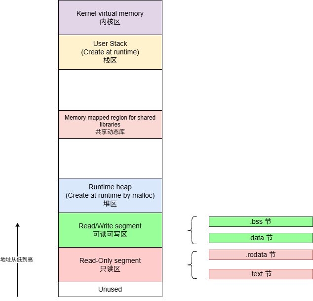

# 基于RISC-V的编译链接和装载04之ELF之节(section)

[TOC]

节是编译器、链接器处理ELF文件的单位，ELF文件将代码，数据等分隔成节来保存，比如，代码保存到.text段中，数据保存到.data段中。

## 1 使用`readelf -S`查看节头

使用`readelf -S`命令查看节头（Section header table）：

~~~sh
$ riscv64-unknown-linux-gnu-readelf -S helloworld.elf
~~~

**注意：**使用-SW宽屏显示更方便查看

其输出为：

~~~sh
$ riscv64-unknown-linux-gnu-readelf -SW helloworld.elf

There are 35 section headers, starting at offset 0x1fc0:

Section Headers:
  [Nr] Name              Type            Address          Off    Size   ES Flg Lk Inf Al
  [ 0]                   NULL            0000000000000000 000000 000000 00      0   0  0
  [ 1] .interp           PROGBITS        0000000000010270 000270 000021 00   A  0   0  1
  [ 2] .hash             HASH            0000000000010298 000298 000024 04   A  4   0  8
  [ 3] .gnu.hash         GNU_HASH        00000000000102c0 0002c0 000030 00   A  4   0  8
  [ 4] .dynsym           DYNSYM          00000000000102f0 0002f0 000060 18   A  5   1  8
  [ 5] .dynstr           STRTAB          0000000000010350 000350 00004a 00   A  0   0  1
  [ 6] .gnu.version      VERSYM          000000000001039a 00039a 000008 02   A  4   0  2
  [ 7] .gnu.version_r    VERNEED         00000000000103a8 0003a8 000030 00   A  5   1  8
  [ 8] .rela.plt         RELA            00000000000103d8 0003d8 000030 18  AI  4  20  8
  [ 9] .plt              PROGBITS        0000000000010410 000410 000040 10  AX  0   0 16
  [10] .text             PROGBITS        0000000000010450 000450 0000aa 00  AX  0   0  4
  [11] .rodata           PROGBITS        0000000000010500 000500 000015 00   A  0   0  8
  [12] .eh_frame_hdr     PROGBITS        0000000000010518 000518 000024 00   A  0   0  4
  [13] .eh_frame         PROGBITS        0000000000010540 000540 000060 00   A  0   0  8
  [14] .note.ABI-tag     NOTE            00000000000105a0 0005a0 000020 00   A  0   0  4
  [15] .preinit_array    PREINIT_ARRAY   0000000000011df0 000df0 000008 08  WA  0   0  8
  [16] .init_array       INIT_ARRAY      0000000000011df8 000df8 000008 08  WA  0   0  8
  [17] .fini_array       FINI_ARRAY      0000000000011e00 000e00 000008 08  WA  0   0  8
  [18] .dynamic          DYNAMIC         0000000000011e08 000e08 0001e0 10  WA  5   0  8
  [19] .got              PROGBITS        0000000000011fe8 000fe8 000008 08  WA  0   0  8
  [20] .got.plt          PROGBITS        0000000000011ff0 000ff0 000020 08  WA  0   0  8
  [21] .sdata            PROGBITS        0000000000012010 001010 000008 00  WA  0   0  8
  [22] .bss              NOBITS          0000000000012018 001018 000008 00  WA  0   0  1
  [23] .comment          PROGBITS        0000000000000000 001018 00002d 01  MS  0   0  1
  [24] .riscv.attributes RISCV_ATTRIBUTES 0000000000000000 001045 0000ca 00      0   0  1
  [25] .debug_aranges    PROGBITS        0000000000000000 00110f 000030 00      0   0  1
  [26] .debug_info       PROGBITS        0000000000000000 00113f 0000b8 00      0   0  1
  [27] .debug_abbrev     PROGBITS        0000000000000000 0011f7 000070 00      0   0  1
  [28] .debug_line       PROGBITS        0000000000000000 001267 000084 00      0   0  1
  [29] .debug_str        PROGBITS        0000000000000000 0012eb 0000d6 01  MS  0   0  1
  [30] .debug_line_str   PROGBITS        0000000000000000 0013c1 000043 01  MS  0   0  1
  [31] .debug_rnglists   PROGBITS        0000000000000000 001404 000017 00      0   0  1
  [32] .symtab           SYMTAB          0000000000000000 001420 000720 18     33  59  8
  [33] .strtab           STRTAB          0000000000000000 001b40 000322 00      0   0  1
  [34] .shstrtab         STRTAB          0000000000000000 001e62 00015c 00      0   0  1
Key to Flags:
  W (write), A (alloc), X (execute), M (merge), S (strings), I (info),
  L (link order), O (extra OS processing required), G (group), T (TLS),
  C (compressed), x (unknown), o (OS specific), E (exclude),
  D (mbind), p (processor specific)
~~~

从log中可以分析如下有用信息：

| 分析维度                   | 关键节/字段                  | 提取到的具体数值/状态                                        | 信息                                                         |
| :------------------------- | :--------------------------- | :----------------------------------------------------------- | :----------------------------------------------------------- |
| **1. 存储与内存占用**      | `.text` (代码)               | `Size` = 0xaa (170 字节)                                     | 存储占用极小，因为标准库（如 `printf`）是动态链接的，未静态编译进固件 |
|                            | `.rodata` (只读常量)         | `Size` = 0x15 (21 字节)                                      | 仅包含字符串格式化控制符或简单常量                           |
|                            | `.sdata` + `.bss` (全局变量) | `.sdata` = 8 字节；`.bss` = 8 字节                           | 运行时 RAM 占用极低（约 16 字节）。其中 `.bss` 类型为 `NOBITS`，在 ELF 文件中不占实际空间，由加载器在内存中申请并清零 |
| **2. 运行环境与平台**      | 动态链接相关节               | 存在 `.interp`, `.plt`, `.got.plt`, `.rela.plt`              | 明确为 Linux 用户态动态链接程序。运行时必须依赖外部的 `ld-linux-riscv64-lp64d.so` 和 `libc.so`，无法在裸机（无 OS）上运行 |
|                            | `.riscv.attributes`          | 存在（Size = 0xca）                                          | 存储了 RISC-V 架构与 ABI 参数（如 `rv64gc` / `lp64d`）。建议执行 `readelf -A` 查看具体指令扩展，以确认能否在当前 CPU 核上运行 |
| **3. 内存布局（VMA映射）** | 代码段基址偏移               | 虚拟地址 `0x10450` - 文件偏移 `0x450` = `0x10000`            | 代码段被映射到内存基址 `0x10000` 处                          |
|                            | 数据段基址偏移               | 虚拟地址 `0x12010` - 文件偏移 `0x1010` = `0x11000`           | 数据段基址为 `0x11000`。代码段结束（约 `0x105C0`）到数据段开始（`0x11DF0`）存在 约 6KB 的空白填充，这是为了满足 MMU 4KB 页大小对齐的强制要求 |
| **4. 编译优化与裁剪**      | 调试信息段                   | `.symtab` = 1.8KB；`.debug_info`/`.line`/`.str` 等总合 > 2KB | 当前为未剥离（Unstripped）版本，调试符号体积远超实际代码。若用于量产，执行 `strip` 命令后，固件体积可从约 8KB 锐减至 2~3KB |
| **5. 启动与初始化流程**    | 构造函数/析构函数表          | 存在 `.preinit_array`, `.init_array`, `.fini_array`          | 启动流程支持 C++ 全局对象构造和 `__attribute__((constructor))` 修饰函数的自动调用。运行 `main` 前会执行这些表中的函数指针 |
| **6. CPU访问效率优化**     | 节对齐（`Al` 列）            | `.plt` = 16 字节；`.text` = 4 字节；`.rodata` = 8 字节       | 对齐符合 RISC-V 规范。`16` 字节对齐满足压缩指令（RVC）的跳转表要求，`8` 字节对齐确保 64 位长整型/指针的原子性读取，避免总线错误 |
| **7. 动态重定位信息**      | 全局偏移表 (GOT)             | `.got.plt` + `.got` 总大小 = `0x28` (40 字节)                | 包含外部函数（如 `puts`/`printf`）的运行时绝对地址占位符。动态链接器会在加载时修正这些地址，若系统缺少对应共享库，程序将报错无法运行 |

## 2 ELF节头的数据结构

以rv64为例，其文件头数据结构为（rv32成员也与一样，只是数据类型不一样，所以文件头长度也不一样）：

~~~c
// https://github.com/roolebo/elfutils/blob/master/libelf/elf.h

typedef struct
{
  Elf64_Word	sh_name;		/* Section name (string tbl index) */
  Elf64_Word	sh_type;		/* Section type */
  Elf64_Xword	sh_flags;		/* Section flags */
  Elf64_Addr	sh_addr;		/* Section virtual addr at execution */
  Elf64_Off	    sh_offset;		/* Section file offset */
  Elf64_Xword	sh_size;		/* Section size in bytes */
  Elf64_Word	sh_link;		/* Link to another section */
  Elf64_Word	sh_info;		/* Additional section information */
  Elf64_Xword	sh_addralign;   /* Section alignment */
  Elf64_Xword	sh_entsize;		/* Entry size if section holds table */
} Elf64_Shdr;
~~~

ELF文件头结构成员含义：

| 序号 | 成员         | 含义                             |
| ---- | ------------ | -------------------------------- |
| 1    | sh_name      | 节名在 `.shstrtab` 中的索引      |
| 2    | sh_type      | 节的类型（代码、数据、符号表等） |
| 3    | sh_flags     | 内存属性（可读、可写、可执行）   |
| 4    | sh_addr      | 运行时虚拟地址                   |
| 5    | sh_offset    | 文件中的偏移                     |
| 6    | sh_size      | 节的大小                         |
| 7    | sh_link      | 关联的其他节索引                 |
| 8    | sh_info      | 附加信息（依赖类型）             |
| 9    | sh_addralign | 对齐要求                         |
| 10   | sh_entsize   | 表类节中每个条目的大小           |

## 3 ELF节头的数据结构各字段详解

1. 节名：sh_name

节区名称在字符串表中的索引。它不是字符串本身，而是一个偏移值，指向 `.shstrtab` 节（Section Header String Table）中的某个位置。

例如：`sh_name = 1` 表示从 `.shstrtab` 的第 1 个字节开始读取节名（如 `.text`、`.data` 等）。

2. 节的类型: sh_type

`sh_type`表示节区的类型，常见值有： 

| 常见值             | 说明                         |
| ------------------ | ---------------------------- |
| SHT_NULL = 0       | 无效节                       |
| `SHT_PROGBITS` = 1 | 程序数据（代码、初始化数据） |
| `SHT_SYMTAB` = 2   | 符号表（用于链接）           |
| `SHT_STRTAB` = 3   | 字符串表                     |
| `SHT_RELA` = 4     | 带加数的重定位表             |
| `SHT_HASH` = 5     | 符号哈希表                   |
| `SHT_DYNAMIC` = 6  | 动态链接信息                 |
| `SHT_NOTE` = 7     | 附加信息（如构建信息）       |
| `SHT_NOBITS` = 8   | 不占用文件空间               |
| `SHT_REL` = 9      | 重定位表（无加数）           |
| `SHT_SHLIB` = 10   | 保留（未使用）               |
| `SHT_DYNSYM` = 11  | 动态符号表（运行时）         |

3. 内存属性: sh_flags

`sh_flags`表示节区的属性，可组合使用： 

| 常见值                         | 说明                         |
| ------------------------------ | ---------------------------- |
| `SHF_WRITE` = 0x1              | 可写（如 `.data`）           |
| `SHF_ALLOC` = 0x2              | 在加载时分配内存空间         |
| `SHF_EXECINSTR` = 0x4          | 包含可执行指令（如 `.text`） |
| `SHF_MERGE` = 0x10             | 内容可合并（如常量字符串）   |
| `SHF_STRINGS` = 0x20           | 包含 null 结尾的字符串       |
| `SHF_INFO_LINK` = 0x40         | `sh_info` 字段指向另一个节   |
| `SHF_LINK_ORDER` = 0x80        | 需按特定顺序链接             |
| `SHF_OS_NONCONFORMING` = 0x100 | 非标准操作系统处理           |
| `SHF_GROUP` = 0x200            | 属于节组                     |
| `SHF_TLS` = 0x400              | 线程局部存储                 |

4. 运行时虚拟地址: sh_addr

`sh_addr`表示 节区在内存中的虚拟地址（运行时地址）。

如果该节需要被加载到内存（如 `.text`, `.data`），此字段表示它在进程地址空间中的位置。对于 `.bss` 或调试节，可能为 0。 

5. 文件中的偏移: sh_offset

`sh_offset` 表示节区内容在 ELF 文件中的偏移量（字节为单位）。

例如：`.text` 节的内容从文件的第 `sh_offset` 字节开始，长度为 `sh_size`。

6. 节的大小: sh_size

`sh_size`表示节区的大小（字节），如果是 `SHT_NOBITS` 类型（如 `.bss`），此值表示运行时分配的内存大小，但在文件中不占空间。

7. 关联的其他节索引: sh_link

`sh_link`表示指向另一个节区的索引，具体含义取决于 `sh_type`：

| 常见值                    | 说明                    |
| ------------------------- | ----------------------- |
| `SHT_DYNAMIC`             | 指向 `.dynstr` 字符串表 |
| `SHT_HASH`                | 指向 `.dynsym` 符号表   |
| `SHT_REL`/`SHT_RELA`      | 指向要重定位的节        |
| `SHT_SYMTAB`/`SHT_DYNSYM` | 指向 `.strtab` 字符串表 |

8. 附加信息（依赖类型）

`sh_info`表示附加信息，含义也依赖于 `sh_type`：

| 常见值               | 说明                   |
| -------------------- | ---------------------- |
| `SHT_REL`/`SHT_RELA` | 重定位应用的符号表索引 |
| `SHT_SYMTAB`         | 第一个非全局符号的索引 |
| `SHT_GROUP`          | 组内第一个成员的索引   |

9. 对齐要求: sh_addralign

`sh_addralign`表示节区在内存和文件中的对齐方式（必须是 2 的幂）。

例如：值为 `16`，表示该节必须按 16 字节对齐。若为 0 或 1，表示无对齐要求。

10. 表类节中每个条目的大小: sh_entsize

`sh_entsize`表示节区中每个条目的固定大小（适用于表类节）。

例如：

`.symtab`：每个符号 `sizeof(Elf64_Sym)` = 24 字节

`.rela`：每个重定位项 `sizeof(Elf64_Rela)` = 24 字节

非表类节（如 `.text`）：此值为 0

## 4 RISC-V常用节的简单说明

1. `.text`节
- **类型**：`SHT_PROGBITS`  
- **标志**：`SHF_ALLOC + SHF_EXECINSTR`  
- **用途**：保存编译后的机器指令（例如 `add`, `jal`, `lw` 等）的代码节。通常只读且可执行，位于 Flash 或 RAM 中。

2. `.data`节
- **类型**：`SHT_PROGBITS`  
- **标志**：`SHF_ALLOC + SHF_WRITE`  
- **用途**：存放已初始化的全局变量和静态变量（例如 `int x = 10;`）。运行时从 ELF 文件复制到内存，可读写。

3. `.bss`节
- **类型**：`SHT_NOBITS`  
- **标志**：`SHF_ALLOC + SHF_WRITE`  
- **用途**：存放未初始化的全局变量和静态变量（例如 `int y;` 或 `static char buf[1024];`）。在文件中不占用空间，但运行时由系统分配内存并初始化为零。

4. `.rodata`节
- **类型**：`SHT_PROGBITS`  
- **标志**：`SHF_ALLOC`  
- **用途**：存放只读数据，如字符串字面量、`const` 修饰的全局常量（例如：`const char *msg = "Hello"`）。通常位于 ROM 或 Flash 中，不可写。

5. `.rela.plt`节

- **类型**：`SHT_RELA`  
- **标志**：`SHF_ALLOC + SHF_INFO_LINK`（通常）  
- **用途**：用于 `.plt` 的重定位条目（带加数），在动态链接时修正函数地址，支持延迟绑定（Lazy Binding）。

6. `.plt`节（过程链接表）

- **类型**：`SHT_PROGBITS`  
- **标志**：`SHF_ALLOC + SHF_EXECINSTR`  
- **用途**：过程链接表，用于动态调用外部函数。包含一小段跳转代码，通过 `.got.plt` 和动态链接器解析实际地址。

7. `.dynamic`节

- **类型**：`SHT_DYNAMIC`  
- **标志**：`SHF_ALLOC + SHF_WRITE`  
- **用途**：动态段，包含动态链接所需的各种结构（如依赖库列表、重定位表地址等），由动态链接器解析。

8. `.got`节（全局偏移表）

- **类型**：`SHT_PROGBITS`  
- **标志**：`SHF_ALLOC + SHF_WRITE`  
- **用途**：全局偏移表，用于存储全局变量和函数地址的实际位置，供位置无关代码（PIC）访问。通常 `.got` 存放全局变量地址，`.got.plt` 存放函数地址。

9. `.got.plt`节

- **类型**：`SHT_PROGBITS`  
- **标志**：`SHF_ALLOC + SHF_WRITE`  
- **用途**：专用于 `.plt` 的全局偏移表，存放动态函数解析后的实际地址，支持延迟绑定。

10. `.init`节
- **类型**：`SHT_PROGBITS`  
- **标志**：`SHF_ALLOC + SHF_EXECINSTR`  
- **用途**：包含构造函数（C++）或初始化代码，在 `main` 函数之前执行，用于调用 `__libc_init_array` 等启动初始化例程。

11. `.fini`节
- **类型**：`SHT_PROGBITS`  
- **标志**：`SHF_ALLOC + SHF_EXECINSTR`  
- **用途**：包含析构函数代码，在程序退出时执行（如 `atexit` 注册的函数），用于资源清理。

12. `.init_array`节
- **类型**：`SHT_PROGBITS`  
- **标志**：`SHF_ALLOC + SHF_WRITE`  
- **用途**：函数指针数组，每个指针指向一个需要在 `main` 之前执行的初始化函数。链接器生成此表，`__libc_init_array` 会遍历调用。

13. `.fini_array`节
- **类型**：`SHT_PROGBITS`  
- **标志**：`SHF_ALLOC + SHF_WRITE`  
- **用途**：析构函数指针数组，程序退出时按顺序调用其中指向的函数。

14. `.comment`节
- **类型**：`SHT_PROGBITS`  
- **标志**：无（或 `SHF_MERGE + SHF_STRINGS`，视具体情况）  
- **用途**：存放编译器版本、构建信息等纯文本注释，仅供调试追踪，不加载到内存。

15. `.note.gnu.build-id`节
- **类型**：`SHT_NOTE`  
- **标志**：无（通常 `SHF_ALLOC` 可选）  
- **用途**：包含唯一标识该 ELF 文件的构建 ID（Build ID），用于调试、崩溃转储和版本追踪。

16. `.symtab`节
- **类型**：`SHT_SYMTAB`  
- **标志**：无  
- **用途**：符号表，包含函数名、变量名及其地址、大小等信息，用于链接和调试。发布版本通常用 `strip` 删除以减小体积。

17. `.strtab`节
- **类型**：`SHT_STRTAB`  
- **标志**：无  
- **用途**：字符串表，存储 `.symtab` 中所有符号名称的字符串，以空字符分隔。

18. `.shstrtab`节
- **类型**：`SHT_STRTAB`  
- **标志**：无  
- **用途**：节区名称字符串表，存放所有节区名（如 `.text`、`.data`），节区头中的 `sh_name` 索引指向此表。

19. `.debug_*`节（如 `.debug_info`、`.debug_line` 等）
- **类型**：`SHT_PROGBITS`  
- **标志**：无（通常不带 `SHF_ALLOC`）  
- **用途**：包含 DWARF 调试信息（如类型定义、行号映射），供 GDB 等调试器使用，不加载到目标设备内存。

20. `.stack`节
- **类型**：`SHT_NOBITS`  
- **标志**：`SHF_ALLOC + SHF_WRITE`  
- **用途**：在某些链接脚本中显式定义栈空间，通常由 `.bss` 或运行时动态分配，并非所有系统都有此节。

21. `.vectors` 或 `.vector`节
- **类型**：`SHT_PROGBITS`  
- **标志**：`SHF_ALLOC + SHF_EXECINSTR`  
- **用途**：中断向量表，在 RISC-V 中通常存放异常和中断处理程序的跳转地址，位于内存起始地址（如 `0x80000000`）。

22. `.boot` 或 `.startup`节
- **类型**：`SHT_PROGBITS`  
- **标志**：`SHF_ALLOC + SHF_EXECINSTR`  
- **用途**：启动代码，包含复位处理、栈指针初始化、清除 `.bss`、复制 `.data`，最后跳转到 `main`。

23. `.flash`（自定义）
- **类型**：通常为 `SHT_PROGBITS`（自定义类型）  
- **标志**：`SHF_ALLOC`（可能加 `SHF_WRITE`）  
- **用途**：用户自定义的 Flash 存储区，用于存放固件镜像、配置参数或只读数据

24. `.interp`节
- **类型**：`SHT_PROGBITS`  
- **标志**：`SHF_ALLOC`  
- **用途**：动态链接器（解释器）的路径字符串，用于指定程序运行所需的动态链接器（如 `/lib/ld-linux-riscv64-lp64d.so.1`）。仅在动态链接程序中存在。

25. `.hash` / `.gnu.hash`节
- **类型**：`SHT_HASH` / `SHT_GNU_HASH`  
- **标志**：`SHF_ALLOC`  
- **用途**：符号哈希表，用于加速动态链接时符号查找。`.gnu.hash` 是 GNU 扩展，更高效，两者可共存。

26. `.dynsym`节
- **类型**：`SHT_DYNSYM`  
- **标志**：`SHF_ALLOC`  
- **用途**：动态符号表，包含动态链接所需的导入/导出符号，用于运行时解析。不同于静态符号表 `.symtab`。

27. `.dynstr`节
- **类型**：`SHT_STRTAB`  
- **标志**：`SHF_ALLOC`  
- **用途**：动态符号字符串表，存储 `.dynsym` 中符号名称，供动态链接器使用。

28. `.gnu.version`节
- **类型**：`SHT_VERSYM`  
- **标志**：`SHF_ALLOC`  
- **用途**：版本符号表（Version Symbol Table），为每个动态符号指定版本号，用于版本兼容性检查。

29. `.gnu.version_r`节
- **类型**：`SHT_VERNEED`  
- **标志**：`SHF_ALLOC`  
- **用途**：版本需求表（Version Needed），记录本程序依赖的共享库所需版本信息。

30. `.eh_frame_hdr`节
- **类型**：`SHT_PROGBITS`  
- **标志**：`SHF_ALLOC`  
- **用途**：异常处理帧头，包含用于展开堆栈的索引信息，支持 C++ 异常处理和 `backtrace`。

31. `.eh_frame`节
- **类型**：`SHT_PROGBITS`  
- **标志**：`SHF_ALLOC`  
- **用途**：异常处理帧信息（DWARF 格式），描述栈帧布局，供异常处理库使用。

32. `.note.ABI-tag`节
- **类型**：`SHT_NOTE`  
- **标志**：`SHF_ALLOC`  
- **用途**：标识该 ELF 遵循的 ABI 版本（如 Linux 内核版本），用于确保运行时兼容性。

33. `.preinit_array`节
- **类型**：`SHT_PREINIT_ARRAY`（通常 `SHT_PROGBITS`）  
- **标志**：`SHF_ALLOC + SHF_WRITE`  
- **用途**：预初始化函数指针数组，比 `.init_array` 更早执行，通常用于动态链接器启动前的初始化（极少使用）。

34. `.sdata`节
- **类型**：`SHT_PROGBITS`  
- **标志**：`SHF_ALLOC + SHF_WRITE`  
- **用途**：RISC-V 架构特有的小型数据段，用于存放较小的全局/静态变量（通常通过 `gp` 寄存器快速访问），以优化代码大小和性能。

35. `.riscv.attributes`节
- **类型**：`SHT_RISCV_ATTRIBUTES`（处理器特定）  
- **标志**：无（或 `SHF_ALLOC` 可选）  
- **用途**：存储 RISC-V 目标平台属性（如 ISA 扩展、ABI 版本、硬件特性），用于链接时兼容性检查。

### 4.2 RISC-V运行时内存布局图

RISC-V的运行布局图如下所示：

**地址的分配：**

程序源码经过编译后，其元素会编译整理到节中，分配如下表：

| 程序中的元素            | 分配的节  |
| ----------------------- | --------- |
| 代码                    | .text节   |
| 字符串常量以及const常量 | .rodata节 |
| 已初始化的全局变量      | .data节   |
| 已初始化的局部静态变量  | .data节   |
| 初始化为0的全局变量     | .bss节    |
| 未初始化全局变量        | .bss节    |
| 未初始化的局部静态变量  | .bss节    |
| 局部变量                | 栈空间    |

可见：放到栈区的局部变量可能是随机值，而没有初始化的全局变量由于放到bss节，所以会被自动初始化为0

**参考：**

1 [一文读懂 .bss段 的作用](https://blog.csdn.net/jxryj/article/details/115008164)