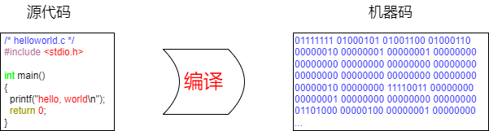
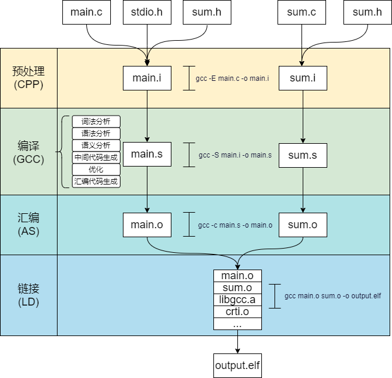
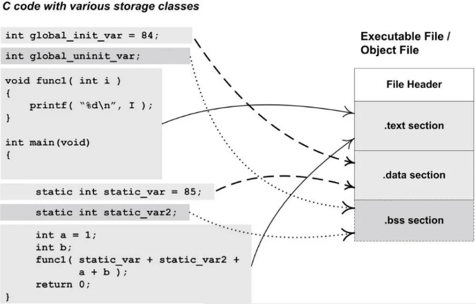

#  基于RISC-V的编译链接和装载06之编译

[TOC]

这篇文档主要讲述编译以及交叉编译。

## 1 程序为什么要编译？

编译的过程其实就是将源程序翻译成CPU能够识别的二进制机器指令的过程。



**源代码（方便人类阅读）：**

例如，如下`helloworld.c`代码，这是给人类看的代码，CPU并不理解什么意思，因为CPU只认识二进制机器码。

~~~c
/* helloworld.c */
#include <stdio.h>

int main(void)
{
  printf("hello, world\n");
  return 0;
}
~~~

**机器码（方便CPU阅读）：**

CPU只认识二进制机器码，如下是`helloworld ELF`的反汇编（局部），三列内容分别是地址，二进制机器码，对应的汇编指令。实际放到内存中的只有机器码，也即第二列的内容。

~~~asm
   # 第一列：地址  二列：机器码              三列：反汇编指令
   10450 <main>:
   10450:       6541                    lui     a0,0x10
   10452:       1141                    addi    sp,sp,-16
   10454:       50850513                addi    a0,a0,1288 # 10508 <_IO_stdin_used+0x8>
   10458:       e406                    sd      ra,8(sp)
   1045a:       fe7ff0ef                jal     10440 <puts@plt>
   1045e:       60a2                    ld      ra,8(sp)
   10460:       4501                    li      a0,0
   10462:       0141                    addi    sp,sp,16
   10464:       8082                    ret
~~~

如果某天，哪个大神直接使用01来编程，那么CPU直接可以理解，就不需要编译汇编等过程了。

## 2 编译的过程

一些底层软件面试总爱问一个问题：编译过程分为哪几步？

这个问题比较基础，主要通过这个问题来了解面试者对编译链接过程是否有一些概念。

对于C语言类似的编译性语言：

* 编译如果从广义来说，表示源码从**预处理（Prepressing）->编译（Compilation）->汇编（Assembly）->链接（Linking）**的整个流程；

* 狭义上的编译就是其中编译（从`.i` 文件到`.s` 文件）这一步；




### 2.1 预处理（Prepressing）

对于C语言，预处理一般之使用`#`表示的语句，提供预处理命令是为了方便编程：

常见的预处理命令如下表：

| 类别         | 命令                                                   | 主要用途                                       |
| :----------- | :----------------------------------------------------- | :--------------------------------------------- |
| 文件包含     | `#include`                                             | 插入头文件内容，可以实现模块化编程             |
| 宏定义       | `#define`、`#undef`                                    | 定义/取消符号常量或宏函数，提高程序可读性      |
| 条件编译     | `#if`、`#ifdef`、`#ifndef`、`#else`、`#elif`、`#endif` | 选择性编译代码，方便让代码兼容不同的处理器平台 |
| 错误/警告    | `#error`、`#warning`                                   | 编译时输出消息                                 |
| 调试优化相关 | `#line`、`#pragma`                                     | 修改行号、编译器指令                           |
| 字符串化     | `#`、`##`                                              | 宏参数转换（宏内使用）                         |

预处理过程主要包括以下操作：

1. 头文件展开，将`#include`包含的头文件展开
2. 宏展开，将`#define`定义的常量展开
3. 条件编译，处理`#if`、`#ifdef`、`#endif`等包括的内容，丢弃掉其余分支
4. 删除注释，注释是给人类阅读的，机器完全不需要
5. 添加行号与文件标识

### 2.2 编译（Compilation）

一个完整的编译（狭义）过程通常分为以下几个主要阶段：

| 阶段                                            | 说明                                                         |
| ----------------------------------------------- | ------------------------------------------------------------ |
| 1. 词法分析（Lexical Analysis）                 | 将源代码分解成“词法单元”（Tokens），如关键字、标识符、运算符等 |
| 2. 语法分析（Syntax Analysis / Parsing）        | 根据语言的语法规则，将 Token 流构建成抽象语法树（AST）       |
| 3. 语义分析（Semantic Analysis）                | 检查 AST 是否符合语言的语义规则（如类型匹配、变量声明等），并生成带注解的 AST |
| 4. 中间代码生成（Intermediate Code Generation） | 将 AST 转换为一种与目标机器无关的中间表示（IR），如 GIMPLE、RTL、LLVM IR 等 |
| 5. 优化（Optimization）                         | 对中间代码进行各种优化（如常量折叠、死代码消除、循环优化等） |
| 6. 目标代码生成（Code Generation）              | 将优化后的中间代码转换为目标架构的汇编代码                   |

### 2.3 汇编（Assembly）

汇编过程是将**汇编代码（.s）** 翻译成**目标文件（.o）**，同时构建 ELF 结构的过程。

换句话说：汇编过程是将汇编代码翻译成对应的二进制指令。同时生成一些必要信息，以节(section)的形式组装到目标文件中。

### 2.4 链接（Linking）

链接器将多个目标文件"粘合"成一个完整的程序，解决跨文件符号引用，为代码和数据分配最终的运行时地址，并生成操作系统可直接加载执行的 ELF 文件。

后面几篇会重点介绍静态链接与动态链接。


## 3 交叉编译

在一个平台上编译生成另一个平台（目标平台）可运行的程序，这个过程就是交叉编译。

比如我们用RISC-V交叉编译工具链`riscv64-unknown-linux-gnu-gcc` 在x86 机器上编译出能在RISC-V平台运行的ELF，而这个ELF不能在x86 intel机器上运行，原因是显而易见的，交叉编译出的指令是RISC-V指令，在x86 intel上运行会失败（非法指令）。

### 3.1 GCC编译中-I -L -l 等参数的使用

交叉编译要熟练掌握`riscv64-unknown-linux-gnu-gcc` 与 `-I`, `-L`, `-l` 选项的搭配使用，这三个选项分别控制编译和链接过程中对头文件、库文件路径和库名称的搜索，熟练掌握这三者的使用，是进行复杂项目交叉编译的基础。

| 选项 | 全称/含义    | 作用阶段                   | 作用                                                         |
| :--- | :----------- | :------------------------- | :----------------------------------------------------------- |
| `-I` | Include      | 预处理阶段 (Preprocessing) | 指定编译器搜索 头文件**（`.h`, `.hpp`）的额外目录            |
| `-L` | Library Path | 链接阶段 (Linking)         | 指定链接器搜索库文件（`.a`, `.so`）的额外目录                |
| `-l` | link library | 链接阶段 (Linking)         | 指示链接器链接指定名称的库文件。它会自动查找 `lib<name>.a` 或 `lib<name>.so` |

**交叉编译举例：**

```bash
$ riscv64-unknown-linux-gnu-gcc \
    -I/path/to/libA/include \           # -I告诉编译器去哪找头文件， -I 可以有多个
    -L/path/to/libA/lib \               # 告诉链接器去哪找 libmylib.a, -L 可以有多个
    -lmylib \                           # 告诉链接器要链接 libmylib.a (自动补全为 libmylib.a/.so)
    -lpthread \                         # 告诉链接器要链接 libpthread (系统库)
    -o main main.c
```


## 4 编译问题探讨

### 4.1 为什么编译要分节？

源代码编译后，代码部分会放到`.text`节，数据部分会放到`.data`节，只读数据放到`.rodata`节等等，之前一直有个疑问，为什么要分节，分节有什么好处，不分节行不行？以下对这些情况进行分析：

有如下原因：

**原因1：安全原因（最致命）**

现代操作系统和 CPU 遵循 **W^X**（Write or eXecute, but not both）安全原则，也即：

- `.text` 节（代码）：标记为 可执行（X）、可读（R），但 不可写（W）
- `.data` 节（数据）：标记为 可读（R）、可写（W），但 不可执行（X）

如果代码和数据混合在一起，攻击者可能向数据区写入恶意机器码（如缓冲区溢出），然后跳转到该数据区执行，实现代码注入攻击。通过分离 `.text` 和 `.data`，，操作系统可以避免这种攻击。

**原因2：性能原因：**

现代 CPU 通常采用 哈佛架构（Harvard Architecture）的缓存设计，CPU 可以同时从 I-Cache 取指令，从 D-Cache 读写数据，如果代码和数据混合，缓存效率会显著下降。

**原因3：内存共享：**

多个进程运行同一个程序时，`.text` 节可以共享物理内存页（只读 + 可执行），每个进程的 `.data` 节必须有独立副本（可写），如果代码和数据混合，就无法实现这种高效的内存共享。

**原因4：链接与重定位的便利性：**

在链接阶段，链接器需要对代码中的符号引用进行重定位（Relocation）。如果代码和数据混合，重定位表会变得极其复杂，难以管理。

分离后：`.text` 节的重定位集中在代码段，`.data` 节的重定位集中在数据段，链接器可以按节处理，逻辑清晰。

**总结:**

分离 `.text` 和 `.data` 是现代操作系统和硬件协同设计的结果，是安全性、性能和可维护性的必然要求。

### 4.2 从源码到目标文件

从编码经过**预处理（Prepressing）->编译（Compilation）->汇编（Assembly）** 得到目标文件，那具体是哪个步骤产生节呢？

答案是汇编这一步，从汇编文件汇编后得到节

具体来说：

* 编译（狭义）生成的是汇编代码（.s 文件），它只“标记”了节的归属；在 `.s` 文件中，编译器会插入各种汇编伪指令（Directives），其中最核心的就是 **`.section`**，用来告诉汇编器：“接下来的内容属于哪个节”。
* 汇编器真正把代码和数据“打包”成目标文件中各个节（Section）


下图来自《程序员的自我修养—链接、装载与库》的3.2节：



由图可见，其元素的空间分配符合下表：

| 程序中的元素            | 分配的节  |
| ----------------------- | --------- |
| 代码                    | .text节   |
| 字符串常量以及const常量 | .rodata节 |
| 已初始化的全局变量      | .data节   |
| 已初始化的局部静态变量  | .data节   |
| 初始化为0的全局变量     | .bss节    |
| 未初始化全局变量        | .bss节    |
| 未初始化的局部静态变量  | .bss节    |
| 局部变量                | 栈空间    |


**参考：**

1. [Makefile的使用](https://www.cnblogs.com/sureZ-learning/p/16622972.html)
2. [程序编译(1)-目标文件的编译步骤 - jesonwoo - 博客园](https://www.cnblogs.com/jesonwoo/p/16005089.html)
3. 《程序员的自我修养—链接、装载与库》

