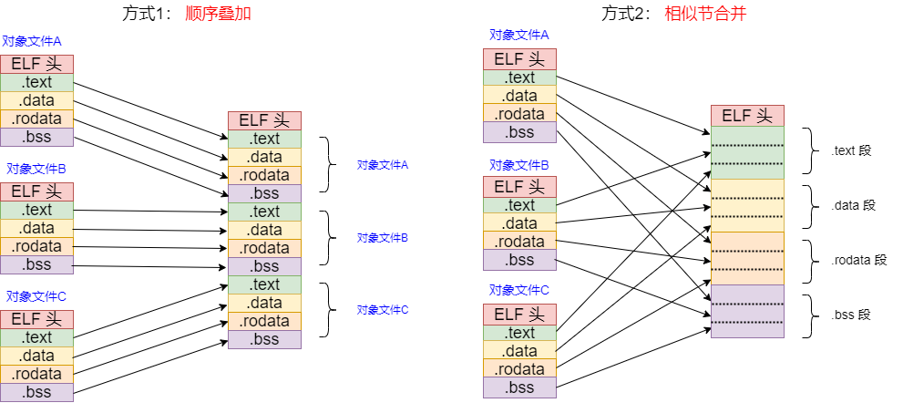
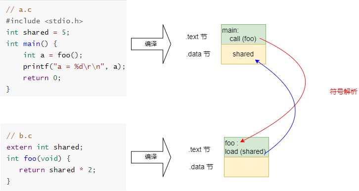

#  基于RISC-V的编译链接和装载07之静态链接

[TOC]

静态链接是将多个目标文件和库文件合并为一个可执行文件的过程。它主要包括如下三步：

1. **节合并**：将相同类型的节（如 `.text`、`.data`）合并成更大的、连续的节，确定了基本内存布局；
2. **符号解析**：建立符号引用与定义的关联，解决跨文件的函数和变量引用；
3. **重定位**：根据前两步的结果，修正所有地址引用，为代码和全局变量分配最终地址。

## 1 节合并

### 1.1 相似节合并

上一章讲述了每个源文件经过编译后分节存放，链接就是将这些节合并起来，对于多个输入目标文件，链接器怎么合并它们呢？最终目标文件的节是怎么摆放呢？有如下两种合并方式：

* 方式1： 顺序叠加
* 方式2：相似节合并




**方式1：顺序叠加**

将目标文件按照次序依次叠加起来，比较简单，但是这么做会造成一些问题：

1. 内存碎片，每个节可能都有对齐需求，成千上万个节就会造成较大的空间浪费；
2. 安全原因，因为代码段要放到只读区，数据段要放到可读可写区，如果区间的权限交替，不是很好控制。

**方式2：相似节合并（标准）**

将多个目标文件中相同类型的节（section）合并成一个连续的节，这种是标准做法。


**控制节组装顺序：**

既然已经确定了使用相似节合并方式，接下来，如何指定程序各个节的组装顺序呢？

答案是：**链接脚本**，第12章将讲述链接脚本的一些知识，下面举一个例子来说明。


### 1.2 用链接脚本控制节的组装顺序

这里用一个简单例子来说明使用链接脚本控制节的组装顺序，以及精确控制不同源文件的节合并顺序。

假设我们要链接如下两个文件（用例见 02_static_link）：

第一个文件`a.c`定义了一个全局变量 shared以及main函数，在main函数中引用了foo函数

第二个文件`b.c`引用了全局变量 shared，以及定义了foo函数

~~~c
// a.c
int shared = 5;       // 定义全局变量shared
int main() {          // 定义main函数
    int a = foo();    // 引用foo函数
    return 0;
}

// b.c
extern int shared;

int foo(void) {        // 定义foo函数
   return shared * 2;  // 引用全局变量shared
}
~~~

编译：

~~~sh
$ cd riscv-elf-link-load/test/02_static_link
$ make
~~~

提供了3个链接脚本：

**脚本1：控制最终输出节（Output Sections）的先后顺序，.text节放到.data节前**

~~~ld
/* 
 * linker_1.lds
 * 第一个脚本，起始地址放在0x10000，.text节放到.data节前
 */
SECTIONS {
    . = 0x10000;

    .text : { *(.text) }

    .data : { *(.data) }
}
~~~

在Makefile中修改`LDSCRIPT := linker_1.lds`, 编译后，可以查看反汇编或者直接查看符号位置：

~~~sh
$ riscv64-unknown-linux-gnu-nm static_link.elf
0000000000010022 T foo
0000000000010000 T main
00000000000100b0 D shared
~~~

其中`shared`是定义全局变量，放在.data节，`foo`与`main`函数属于.text节

可见：.text节放到.data节前，a.o 的.text节（main函数）放到b.o 的.text（foo函数）前（可以与第三个链接脚本比较）

**脚本2：控制最终输出节（Output Sections）的先后顺序，.data节放到.text节前**

~~~ld
/* 
 * linker_2.lds
 * 第二个脚本，调整节之间的顺序，.data节放到.text节前
 */
SECTIONS {
    . = 0x10000;

    .data : { *(.data) }

    .text : { *(.text) }
}
~~~

在Makefile中修改`LDSCRIPT := linker_2.lds`, 编译后，可以查看反汇编或者直接查看符号位置：

~~~sh
riscv64-unknown-linux-gnu-nm static_link.elf
0000000000010026 T foo
0000000000010004 T main
0000000000010000 D shared
~~~

可见：使用这个链接脚本，.data节放到.text节前

**脚本3：控制不同源文件（目标文件）的节合并顺序**

实现方式：在链接脚本中，不使用 `*(.text)` 这种全局通配符，而是显式指定具体的目标文件。如：

*  在链接脚本中，在输出节的大括号 `{ }` 内，可以通过指定文件名来控制合并顺序，如将`a.o(.text)` 放在 `b.o(.text)` 前面
* 或通过调整命令行调整目标文件的输入顺序

~~~ld
/* 
 * linker_3.lds
 * 第三个脚本，精确控制不同源文件的节合并顺序，b.o 的.text节放到a.o 的.text前
 */
SECTIONS {
    . = 0x10000;
    .text : {
        b.o(.text)
        a.o(.text)
    }

    .data : { *(.data) }
}
~~~

在Makefile中修改`LDSCRIPT := linker_3.lds`, 编译后，可以查看反汇编或者直接查看符号位置：

~~~sh
$ riscv64-unknown-linux-gnu-nm static_link.elf
0000000000010000 T foo
0000000000010020 T main
00000000000100b0 D shared
~~~

可见：使用这个链接脚本，b.o 的.text节放到a.o 的.text前


**脚本4：控制同一源文件内部符号/节的先后顺序**

上述3个脚本演示了控制节之前的前后顺序，以及不同源文件的符号顺序，更进一步的还能更细致的控制某个源文件内部符号的先后顺序吗？比如 `a.c` 有多个函数`foo()` 以及 `main()` 等，能控制这些函数的顺序吗？

回答：可以进一步调节，但这已经超出了普通链接脚本（Linker Script）的能力，需要编译器（Compiler）和链接脚本配合来实现。

在默认情况下，编译器会将同一个源文件中的所有代码打包到一个 `.text` 段中，链接器无法“拆开”它们。要实现源文件内部符号（如不同的函数）的排序，需要让编译器为每个符号生成独立的段，然后由链接脚本对这些独立段进行排序。编译器与链接器分别要做如下工作：

* 在编译源文件时，需要加上 `-ffunction-sections`（针对函数）或 `-fdata-sections`（针对全局变量）选项。

* 链接脚本配合：拆分后，链接脚本就可以像对待不同文件一样，使用 `a.o(.text.foo)` 和 `a.o(.text.main)` 来精确控制同一文件内部符号的先后顺序。

如果同一文件内有大量的函数被拆分成了独立的节，我们不需要在链接脚本中一个个手写。可以直接利用链接脚本内置的 `SORT()` 关键字（例如 `*(SORT(.text.*))`），让链接器自动按照字母顺序或其他规则对这些内部节进行排序，这在大型项目中非常实用。


## 2 符号解析

多个目标中的节（section）并不是独立的，这个目标文件可能需要调用另外一个目标文件的全局变量或者函数，符号解析（symbol resolution）将符号引用与符号定义关联起来，解决目标文件之间的符号依赖关系。

**查看目标文件符号表：**

查看 `a.o` 的符号

~~~sh
# 查看 a.o 的符号
$ riscv64-unknown-linux-gnu-nm a.o

                 U foo
0000000000000000 T main
0000000000000000 D shared
~~~

查看 `b.o` 的符号
~~~sh
# 查看 b.o 的符号
$ riscv64-unknown-linux-gnu-nm b.o
0000000000000000 T foo
                 U shared
~~~

也即：

| 符号     | 定义位置    | 类型 | 地址   |
| -------- | ----------- | ---- | ------ |
| `shared` | a.o (.data) | 数据 | 待确定 |
| `main`   | a.o (.text) | 函数 | 待确定 |
| `foo`    | b.o (.text) | 函数 | 待确定 |

**符号解析：**

其符号解析过程如下：




上述的例子只是最简单的情况，当遇到多个同名的符号，链接器最终决定链接哪个呢？有如下原则：

**同名的符号链接原则（强弱符号规则）：**

1. 强符号不允许多次定义，否则就会发生重定义错误
2. 一个强符号可以与弱符号共存
3. 允许多个弱符号存在，如果有多个弱符号且没有强符号，那么取体积大者弱符号


**注意：**符号解析时有不同规则：“强弱符号规则”与“首次出现原则”，详细情况可以查看《RISC-V Binutils工具链04之ld工具的使用》的2.4节链接过程中的符号处理

## 3 重定位

重定位就是为函数和全局变量分配最终地址。

静态链接过程包括地址粗调与细调：

* 地址粗调：节合并时，初步确定地址（第一节提到使用`linker_1.lds`等链接脚本控制顺序）
* 地址细调：重定位修正，为函数和全局变量分配最终地址，修正指令

### 3.1 查看重定位信息

链接器怎么知道哪些符号需要调整地址呢？这就需要重定位表，重定位表记录了需要重定位的符号。

**查看 `a.o` 的重定位表：**

~~~sh
# 查看 a.o 的重定位表
$ riscv64-unknown-linux-gnu-objdump -r a.o 

a.o:     file format elf64-littleriscv

RELOCATION RECORDS FOR [.text]:
OFFSET           TYPE              VALUE
0000000000000008 R_RISCV_CALL_PLT  foo
0000000000000008 R_RISCV_RELAX     *ABS*


RELOCATION RECORDS FOR [.eh_frame]:
OFFSET           TYPE              VALUE
000000000000001c R_RISCV_32_PCREL  .L0
0000000000000020 R_RISCV_ADD32     .L0
0000000000000020 R_RISCV_SUB32     .L0
0000000000000031 R_RISCV_SET6      .L0
0000000000000031 R_RISCV_SUB6      .L0
~~~

从上述log可以看出：foo函数的重定位类型为R_RISCV_CALL_PLT，这个标签同时打上R_RISCV_RELAX标签，表示可以被链接松弛优化。 后部分表示异常帧（.eh_frame）的重定位信息，与DWARF调试信息相关，不再详述。

**查看 `b.o` 的重定位表：**

~~~sh
# 查看 b.o 的重定位表
$ riscv64-unknown-linux-gnu-objdump -r b.o

b.o:     file format elf64-littleriscv

RELOCATION RECORDS FOR [.text]:
OFFSET           TYPE              VALUE
0000000000000008 R_RISCV_HI20      shared
0000000000000008 R_RISCV_RELAX     *ABS*
000000000000000c R_RISCV_LO12_I    shared
000000000000000c R_RISCV_RELAX     *ABS*


RELOCATION RECORDS FOR [.eh_frame]:
OFFSET           TYPE              VALUE
000000000000001c R_RISCV_32_PCREL  .L0
0000000000000020 R_RISCV_ADD32     .L0
0000000000000020 R_RISCV_SUB32     .L0
0000000000000031 R_RISCV_SET6      .L0
0000000000000031 R_RISCV_SUB6      .L0
~~~

从上述log可以看出：全局变量`shared`的重定位类型为R_RISCV_HI20与R_RISCV_LO12_I

### 3.2 查看反汇编

查看链接前的反汇编。

**查看`a.o`的反汇编：**

~~~sh
$ riscv64-unknown-linux-gnu-objdump -d -r a.o
a.o:     file format elf64-littleriscv


Disassembly of section .text:

0000000000000000 <main>:
   0:   1101                    addi    sp,sp,-32
   2:   ec06                    sd      ra,24(sp)
   4:   e822                    sd      s0,16(sp)
   6:   1000                    addi    s0,sp,32
   8:   00000097                auipc   ra,0x0
                        8: R_RISCV_CALL_PLT     foo
                        8: R_RISCV_RELAX        *ABS*
   c:   000080e7                jalr    ra # 8 <main+0x8>
  10:   87aa                    mv      a5,a0
  12:   fef42623                sw      a5,-20(s0)
  16:   4781                    li      a5,0
  18:   853e                    mv      a0,a5
  1a:   60e2                    ld      ra,24(sp)
  1c:   6442                    ld      s0,16(sp)
  1e:   6105                    addi    sp,sp,32
  20:   8082                    ret
~~~

main调用foo的指令如下：

~~~log
 auipc   ra,0x0
 jalr    ra # 8 <main+0x8>
~~~

在链接前，不知道foo函数的最终地址，所以暂时使用0x0。链接完成后，确定符号的最终地址，链接器需要更具最终的地址来修正上述指令。

**查看`b.o`的反汇编：**

~~~sh
$ riscv64-unknown-linux-gnu-objdump -d -r b.o

b.o:     file format elf64-littleriscv


Disassembly of section .text:

0000000000000000 <foo>:
   0:   1141                    addi    sp,sp,-16
   2:   e406                    sd      ra,8(sp)
   4:   e022                    sd      s0,0(sp)
   6:   0800                    addi    s0,sp,16
   8:   000007b7                lui     a5,0x0
                        8: R_RISCV_HI20 shared
                        8: R_RISCV_RELAX        *ABS*
   c:   0007a783                lw      a5,0(a5)
                        c: R_RISCV_LO12_I       shared
                        c: R_RISCV_RELAX        *ABS*
  10:   0017979b                slliw   a5,a5,0x1
  14:   2781                    sext.w  a5,a5
  16:   853e                    mv      a0,a5
  18:   60a2                    ld      ra,8(sp)
  1a:   6402                    ld      s0,0(sp)
  1c:   0141                    addi    sp,sp,16
  1e:   8082                    ret
~~~

foo函数加载shared变量的指令如下：

~~~sh
lui     a5,0x0
lw      a5,0(a5)
~~~

同样的，链接时候不知道shared变量的具体位置，所以暂时使用0x0。

### 3.3 重定位详细计算

RISC-V支持多种不同的重定位类型，不同的重定位类型其指令修正方式是不同的，对于本例：

* foo函数的重定位类型R_RISCV_CALL_PLT

* 全局变量`shared`的重定位类型R_RISCV_HI20/R_RISCV_LO12_I 

这里只以这个用例来简单说明函数以及全局变量的修正过程。

**`a.o`重定位计算**：

根据链接脚本，`foo` 函数的最终地址被确定为 `0x10022`，`auipc` 指令的地址是 `0x10004`。

- 目标地址 (S): `0x10022` (`foo` 的地址)
- 当前位置 (P): `0x10008` (`auipc` 指令的地址)
- 地址差 (S - P): `0x10022 - 0x10008 = 0x1A`

RISC-V 使用 PC 相对寻址。`auipc` 和 `jalr` 组合起来，其跳转目标是 `P + (imm20 << 12) + sext(imm12)`，需要将这个地址差 `0x1E` 拆分填入两条指令。

- 计算 `auipc` 的立即数 (高20位):
  为了正确进行四舍五入，计算高20位时需要加上一个偏移量 `0x800` (即 2048)
  `imm20 = (0x1A + 0x800) >> 12 = 0x81A >> 12 = 0`
  所以，`auipc` 指令的立即数被修正为 `0`
- 计算 `jalr` 的立即数 (低12位):
  `imm12 = 0x1A & 0xFFF = 0x1A`
  所以，`jalr` 指令的立即数被修正为 `0x1A` (十进制 26)

重定位后 (在 `static_link.elf` 中):

```
0x10004: 00000097    auipc ra, 0x0      # 高20位是 0
0x10008: 01e080e7    jalr  ra, 26(ra)   # 低12位是 0x1A (26)
```

**b.o 中的重定位处理：**

在 `b.o` 的 `foo` 函数中，访问全局变量 `shared` 同样需要两条指令 `lui` 和 `lw` 协同完成。

1. 重定位前 (在 `b.o` 中):

```
# 假设 foo 函数的起始地址是 0x10022
...
0x1002a: 000007b7    lui  a5, 0x0       # 占位符，等待链接器填入高20位
0x1002e: 0007a783    lw   a5, 0(a5)     # 占位符，等待链接器填入低12位
```

2. 链接器计算:
   根据链接脚本，全局变量 `shared` 的最终地址被确定为 `0x100b0`

- 目标地址 (S): `0x100b0` (`shared` 的地址)

RISC-V 访问全局数据时，`lui` 负责加载高20位，`lw` 负责加载低12位作为偏移

- 计算 `lui` 的立即数 (高20位):
  同样，为了四舍五入，计算高20位时需要加上 `0x800`。
  `imm20 = (0x100b0 + 0x800) >> 12 = 0x108b0 >> 12 = 0x10`
  所以，`lui` 指令的立即数被修正为 `0x10`
- 计算 `lw` 的立即数 (低12位):
  `imm12 = 0x100b0 & 0xFFF = 0x0b0`
  所以，`lw` 指令的立即数被修正为 `0x0b0` (十进制 176)

重定位后 (在 `static_link.elf` 中):

```
0x1002a: 000107b7    lui  a5, 0x10      # 高20位是 0x10
0x1002e: 0b07a783    lw   a5, 176(a5)   # 低12位是 0x0b0 (176)
```

最终得到可执行文件：

~~~sh
$ riscv64-unknown-linux-gnu-nm static_link.elf
0000000000010022 T foo
0000000000010000 T main
00000000000100b0 D shared
~~~

以上便是整个静态链接的几个步骤。


**参考：**

1. 《程序员的自我修养—链接、装载与库》


