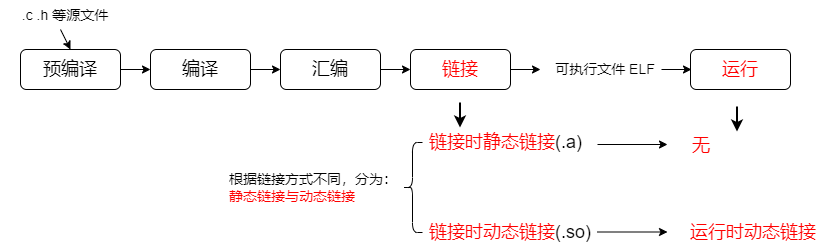
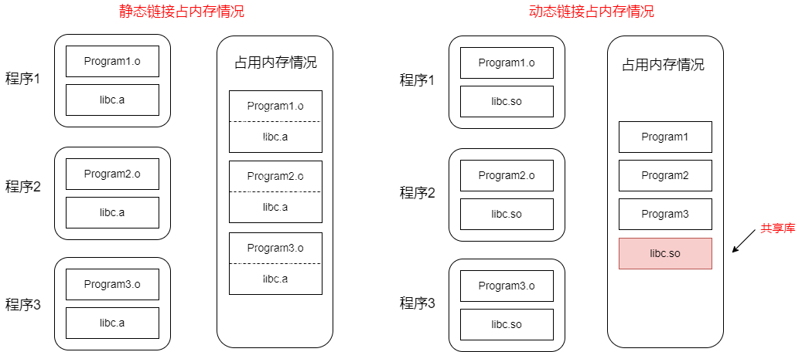
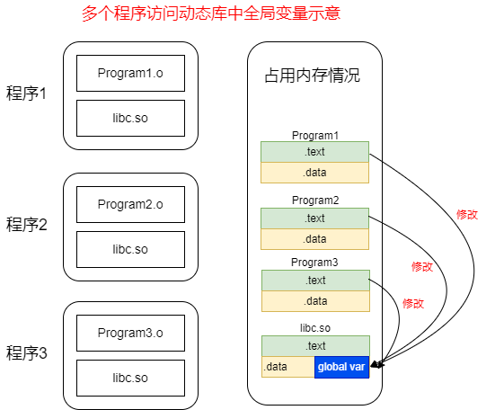
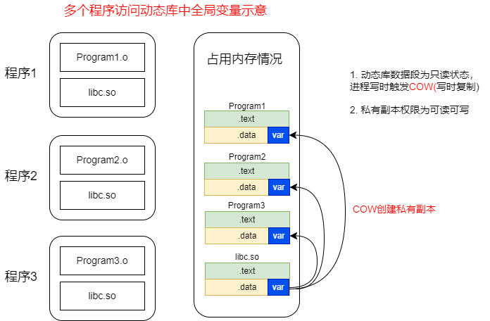
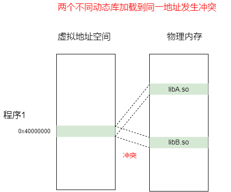
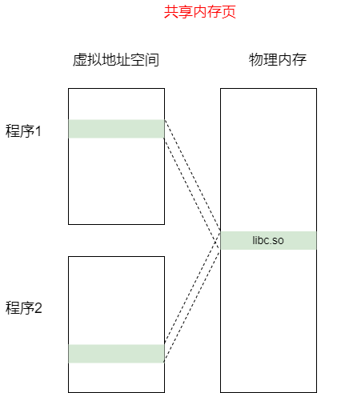
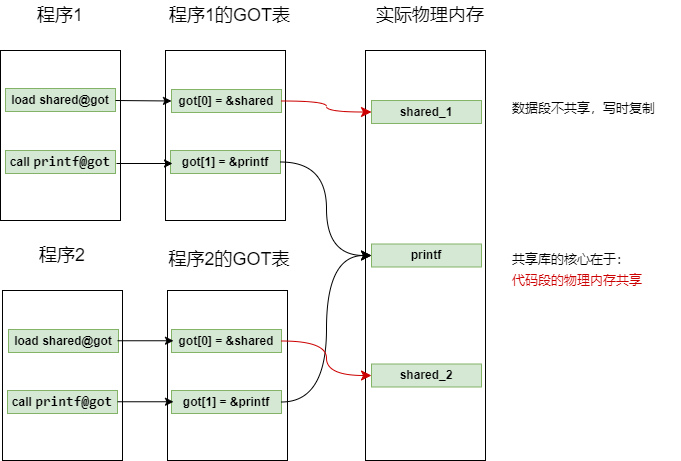

# 基于RISC-V的编译链接和装载09之动态链接1

[TOC]

## 1 为什么要使用动态链接？

**静态链接与动态链接：**

编译过程如下所示，根据链接方式不同分为静态链接与动态链接。

上一章已经详细的分析了静态链接

* 在链接阶段需要我们传入`-static`参数.

* 如果不传`-static`参数，默认是动态链接

动态链接分为两个阶段：

* 编译构建时：发生在编译链接阶段 
* 运行时：发生在程序执行阶段

可以看到静态链接比较简单，更容易理解。那为什么我们又引入相对复杂的动态链接呢？

这是因为静态链接有两个较难忍受的缺点：体积大，不容易维护。

**静态链接：**

静态链接有两个较难忍受的缺点，也即体积大，不容易维护。

* 静态链接程序需要在编译阶段链接所依赖的静态库，例如：假设基础库`libc.a` 大小为1MB，那么如果有2000个程序依赖`libc.a`库，那么就要浪费2GB（非优化情况）空间，所以静态链接对空间浪费十分严重

* 假设基础库`libc.a`有BUG需要更新，那么2000 个程序都需要重新编译发布，这也是非常大的工作量，所以静态链接对于程序的更新、部署、发布很不友好

当然静态链接也有优点，其相比动态链接比较突出的优点是：运行阶段与静态库无关，一个ELF放到不同的环境中都可以正常执行（理论上）。

**动态链接：**

为了减少代码体积，引入动态链接，其核心是：将程序按照模块拆分成各个相对独立的部分（动态库），在程序运行时才将它们链接到一起形成一个完整的程序，而不是像静态链接一样在运行前就将所有程序模块链接成单独可执行文件。

动态链接的优缺点：

* 优点是：文件体积小，更新维护容易，某个动态库有新的版本时，往往只用更新这一个动态库，不需要重新全部编译

* 缺点是：独立性较弱，需要操作系统支持，性能稍有损失（动态链接采用PLT延迟绑定等优化后，相比静态链接性能损失一般小于5%）。

以前面提到的 `01_helloworld`举例：

~~~shell
# STATIC_FLAGS=-static，编译得到静态链接的helloworld_static.elf
$ cd riscv-elf-link-load/test/01_helloworld
$ make

# 修改Makefile，将`STATIC_FLAGS`变量置空,重新make 得到动态链接的helloworld.elf
$ make clean
$ make
~~~

查看可执行文件的codesize：

~~~sh
$ riscv64-unknown-linux-gnu-size helloworld.elf helloworld_static.elf
  text    data     bss     dec     hex filename
    810     552       8    1370     55a helloworld.elf
 424233   21900   21640  467773   7233d helloworld_static.elf
~~~

最直观的结果是:`helloworld_static.elf` 一共 456KB，`helloworld.elf`  一共1KB多，静态链接比动态链接的ELF体积大很多。

**注意：**上面展示的静态链接比动态链接的ELF体积大很多，原因是因为动态链接生成的ELF并不包含libc.so库（动态链接在运行阶段会加载libc.so），而静态链接生成的ELF链接了`libc.a`，所以比较单个可执行程序体积或许并不恰当，但考虑多个ELF场景，如下图所示，假如这些ELF都调用`printf`函数，需要链接`libc`库：

对比可见，如果存在多个ELF都要调用相同的库，使用动态加载只需要保留一份，动态库的确可以大大降低内存的占用。

**静态链接和动态链接的详细对比：**

静态链接除了占用内存大之外，还有维护不便等缺点，以下是静态链接和动态链接的详细对比：

|                    | 静态链接                                                     | 动态链接                                                     |
| :----------------- | :----------------------------------------------------------- | :----------------------------------------------------------- |
| **行为**           | 编译时，将库代码复制到可执行文件中                           | 编译时仅记录依赖，运行时加载库                               |
| **可执行文件大小** | 大                                                           | 小（共享）                                                   |
| **独立性**         | 强，不依赖外部环境                                           | 弱，链接具有不确定性，需要操作系统支持                       |
| **更新维护**       | 困难，需重新编译整个程序                                     | 容易，只需替换库文件                                         |
| **性能**           | 启动快，调用开销小                                           | 启动稍慢（需要链接），调用有微小开销                         |
| **常用场景**       | 1. 需要独立分发，避免依赖问题的程序（如发给不懂电脑的用户）  2. 对性能有极致要求的核心代码 3. 嵌入式系统（可能没有完整的操作系统环境） | 1. 绝大多数桌面应用和服务器软件  2. 系统的核心组件和基础库  3. 需要频繁更新库的场景 |

## 2 动态链接的实现

上面提到，动态链接分为两个阶段：编译构建时与运行时。动态链接的本质是将链接过程推迟到程序运行时。这样不同的程序等到运行时再链接同一个动态库，这就是动态库的共享，解决了静态链接体积大及维护难两个缺点。

### 2.1 动态链接过程：编译链接时->加载时->运行时

在编译链接时，动态链接包含如下三步：

1. **节合并**：除了常规的代码和数据节，链接器会额外生成专用于动态链接的节，如 `.got`（全局偏移表）、`.plt`（过程链接表）、`.dynsym`（动态符号表）和 `.dynamic`（动态段）。
2. **符号解析**：确定哪些符号是外部共享库提供的（标记为 `UND`），并建立动态符号表以供后续查找。
3. **重定位准备**：这是与静态链接最本质的区别。静态链接在这里会直接修正机器码；而动态链接器不会修改代码段（`.text`）或数据段的最终地址，而是生成重定位表（如 `.rela.dyn` 和 `.rela.plt`）以及动态段（`.dynamic`）。

真正的地址修正工作被推迟到程序加载和运行阶段：

- **启动时重定位**：程序加载后、`main` 执行前，动态链接器会解析全局变量等符号，并填充 `.got` 表。
- **运行时延迟绑定**：对于外部函数，只有在首次调用时，才通过 `.got.plt` 和 `_dl_runtime_resolve` 机制，将实际函数地址填入对应的 GOT 槽位。

### 2.2  动态链接遇到的问题以及解决方案

动态库是怎么实现被被多个程序之间共享的呢？动态库共享要解决全局变量以及函数的访问问题，以下分别进行讨论：

**问题1：访问动态库中的全局变量**

考虑如下情况，假设现在有三个运行的程序和一个动态库`libc. so`，动态库中定义了一个全局变量`var`，程序1设置变量`var=10`，程序2设置变量`var=20`，程序3设置`var=30`，如果变量的物理地址一样，那么这样就会造成变量冲突（比如：过段时间，程序1再次访问变量var，发现其值并不是设置的10，程序运行就会出错）。

怎么解决这个冲突呢？

我们需要严格区分共享库中的不被修改部分（代码段）和被修改部分（数据段），代码段可以被共享，数据段不能共享。

具体来说如下：

| libc.so 段              | 是否共享           |
| ----------------------- | ------------------ |
| .text    (代码段，只读) | 所有进程共享       |
| .rodata  (只读数据)     | 所有进程共享       |
| .data    (可写数据)     | 每个进程有私有副本 |
| .bss     (未初始化数据) | 每个进程有私有副本 |

也即采用的解决方案是：

* 代码段共享

* 数据段各个程序自己维护，这其实就是COW（写时复制）机制。COW机制负责在背后为数据创建私有副本，下图是COW机制创建私有副本示意图。

COW创建了私有副本后，不同进程中的 `var`的虚拟地址可能相同或者不同（受ASLR随机化影响，相同只是巧合）。关键是：虚拟地址通过每个进程独立的页表，被映射到了不同的物理内存页上，也即私有副本的物理地址不同。

COW机制解决了访问共享库全局变量的冲突，但共享库的代码段怎么知道各个程序全局变量私有副本的地址呢？这就是GOT的工作，各个模块自己记录私有副本的地址。另外还需注意COW机制需要操作系统以及MMU支持。

**问题2：访问动态库中的函数**

假设动态库`libc.so`中访问一个全局函数`printf`，这个地址可以是固定地址吗？

答案是： 不能，动态库中函数地址不能是固定的绝对地址。

有如下原因：

场景1：单个进程内的库冲突

假设我们有两个库他们有相同的固定地址，当进程尝试加载这两个库时，`0x40000000`位置该放谁？`libA.so`还是`libB.so`？这样便造成了冲突，因为同一个虚拟地址空间内，一个地址只能被一个库占用。

~~~log
// libA.so 要求加载到固定地址 0x40000000
// libB.so 也要求加载到固定地址 0x40000000
~~~

场景2：地址空间布局随机化（ASLR）

现代操作系统默认启用ASLR，每次运行程序时，动态库的加载基地址都会随机变化。

动态库中的函数地址= 库的加载基地址 + 函数在库内的偏移量，也即动态库中函数地址并不能固定。

~~~sh
# 第一次运行
$ ldd /bin/ls | grep libc
	libc.so.6 => /lib/x86_64-linux-gnu/libc.so.6 (0x00007f8a1b000000)

# 第二次运行（地址不同！）
$ ldd /bin/ls | grep libc  
	libc.so.6 => /lib/x86_64-linux-gnu/libc.so.6 (0x00007f8a3c400000)
~~~

在linux 多进程场合，各个进程加载动态库的位置并不能保证完全相同，所以**动态库代码段需要做成地址无关的**（下一章介绍地址无关的概念），这也需要引入GOT来解决个问题。

### 2.3 引入GOT表

计算机领域有个中间层法则：计算机科学领域的任何问题都可以通过增加一个间接的中间层来解决。

对于上述两个问题，可以引入GOT表来解决。GOT 表是怎么解决上述两个问题呢？

GOT的工作示意如下伪代码所示：

~~~c
// GOT表示例（在数据段，内容可被加载器修改）
got[0] = &shared    // 指向全局变量shared
got[1] = &printf    // 指向libc中的printf
~~~

**对于上节问题1：**

各个程序维护全局变量的不同副本，也即共享库中的普通全局变量最终指向的物理地址并不相同（GOT表记录的地址不同），修改互不影响

**注意：**有的时候我们希望各个程序访问共享库同一全局变量怎么办？这时候需要共享库定义的共享的全局变量（特殊申请，MAP_SHARED），那么各个程序引用这个全局变量则是同一个（物理地址相同）。

COW（写时复制）发生在物理内存页级别，不改变虚拟地址，也不更新GOT表！

**对于上节问题2：**

不同进程GOT表中，同一个函数的物理地址相同，使用GOT表记录函数的虚拟地址（GOT表记录的虚拟地址可能相同或者不同，受ASLR影响），关键是其指向的物理地址是相同的。共享库的核心价值就在于代码段的物理内存共享。

**GOT表的内容是什么时候填充的呢？**

GOT表项的值由动态链接器在运行时填充，准确的来说：

* 全局变量的地址在程序加载时就会由动态链接器立即解析并填充；
* 外部函数的地址则采用延迟绑定机制，在函数第一次被调用时才由动态链接器填写

在下一讲将详细讲述。

**参考：**

1. [动态链接库的实现原理是什么？](https://mp.weixin.qq.com/s/_-mRDg06AaiKc4-HZ8PgdQ)
2. [PLT & GOT 表动态链接详解及 pwn 应用_.got.plt 的序号-CSDN博客](https://blog.csdn.net/Zheng__Huang/article/details/119484353)
3. [动态链接中的PLT和GOT原理_.got.plt-CSDN博客](https://blog.csdn.net/Roy1986613/article/details/141221437)
4.  [深入理解GOT表和PLT表 - 知乎](https://zhuanlan.zhihu.com/p/130271689)
5. [深入浅出 PLT/GOT Hook与原理实践 - zxzhang - 博客园](https://www.cnblogs.com/ZhaoxiCheung/p/17871105.html)

