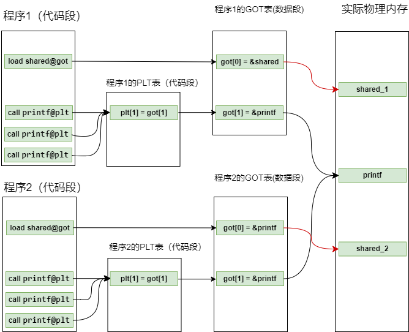
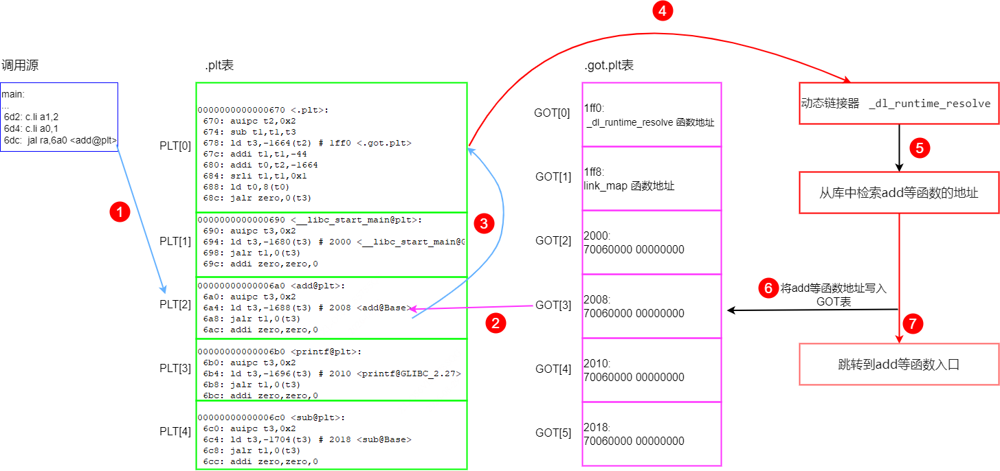
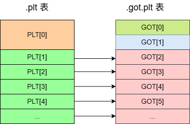
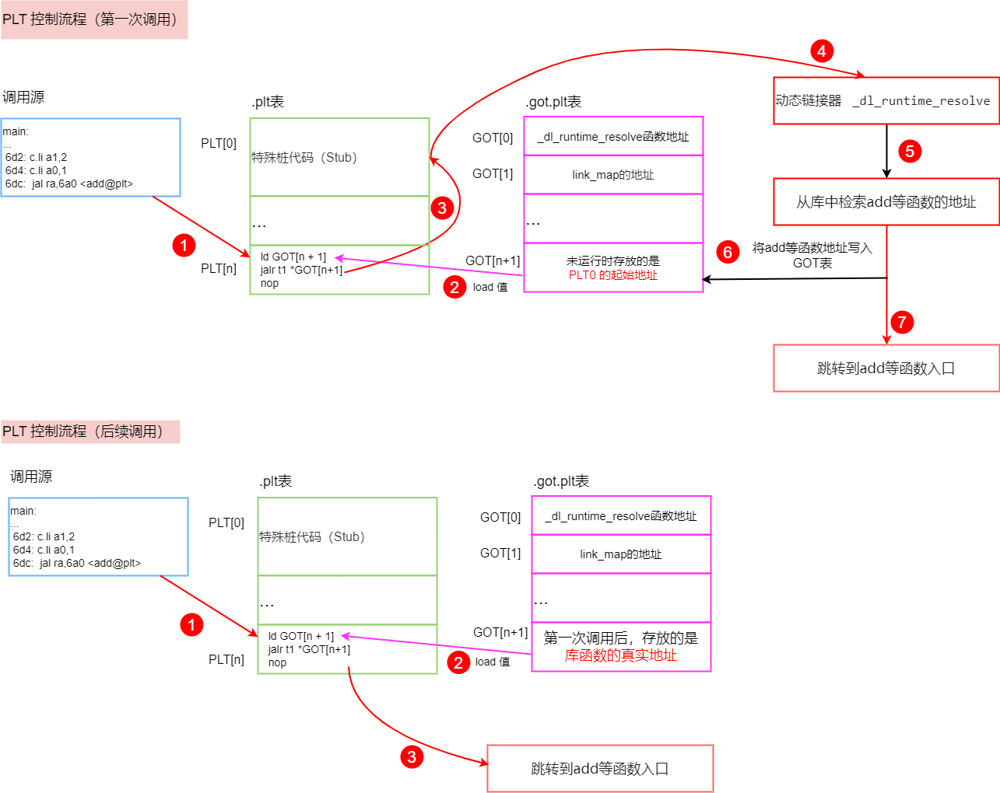
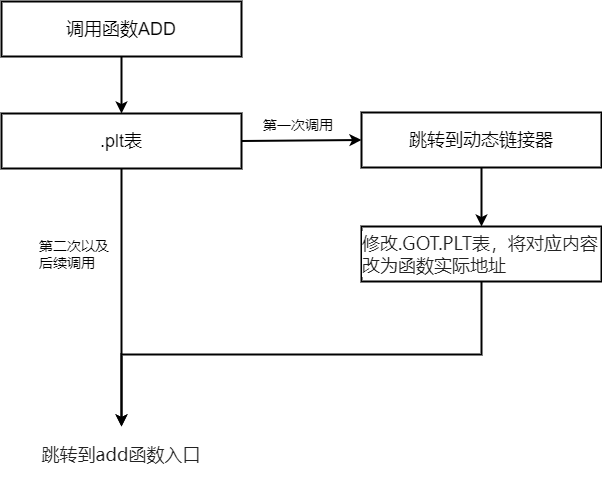

#   基于RISC-V的编译链接和装载10之动态链接2

[toc]

上一章定性的说明了动态链接过程，但是还有一些细节需要继续仔细分析。这一节主要讲述动态链接中的PLT表与GOT表。

## 1 引入GOT表

再简单讲述一下上一节的内容：

动态库的核心在于：代码段的物理内存共享，数据段（全局变量）不共享。

也即：

* 动态库的代码段物理地址是唯一的，共享的。（虚拟地址相同或者不同，受ALSR影响）

* 动态库中的全局变量是不共享的，各个程序的全局变量副本物理地址是不同的（虚拟地址相同或者不同，受ALSR影响）

代码段是只读共享的，这就需要各个程序维护可写的GOT表来记录函数以及全局变量地址。形成如下结构：


GOT表项的值不是在编译时确定的，而是在程序加载时由动态链接器填写的。准确的来说：

* 全局变量的地址在程序加载时就会由动态链接器立即解析并填充；
* 外部函数的地址则采用延迟绑定机制，在函数第一次被调用时才由动态链接器填写

## 2 为什么要引入PLT表？

上述流程已经可以正常工作，但是我们为什么又要引入PLT表呢？引入PLT表是为了优化性能而采取的手段。

**如果没有PLT表会怎么样？**

考虑这种场景，程序中包含大量的函数引用，在程序开始执行前，动态链接器寻找符号名，并将地址填到GOT表中，可以想象，如果解析所有符号将会需要很多时间，而程序运行过程中可能很多函数在执行过程中并不会用到（比如一些else 分支，或者错误处理分支），如果一开始就将所有函数位置找到实际上是一种浪费，性能会变差（更严谨的说：这种一开始全部解析完成也并非一无是处，这种叫做 **RELRO** 技术，在安全领域有应用）。

为了解决这个问题，ELF采用了延迟绑定（Lazy Binding）的做法，其基本思想是：当函数第一次被调用才进行绑定，没有用到的函数不进行绑定。

具体方法是引入了PLT表来实现延迟绑定。

PLT表是针对动态库全局函数而言的，全局变量是加载是立即绑定：

* 动态库中，全局变量的GOT表更新时机是：加载时立即更新，运行时不再更新
* 动态库中，全局函数的GOT表更新时机是延迟绑定（Lazy Binding），具体是第一次调用时更新，再后面调用不用更新

其示意图(只是示意图，真实情况有一些差别，比如plt表与got表的映射关系并不是这样对应的，后续会讲到)如下：



为什么全局变量不引入延迟绑定机制呢？大概有如下原因：

* 函数访问其实就是一次跳转，所以可以跳转到第三方中转，而全局变量访问是读/写操作，不好拦截以及中转，从后面的细节分析可以体会到这点；
* 全局变量可能在main函数之前已经用到了，所以要提前准备好；
* 另外全局变量一般数量较少


## 3 动态链接的详细流程（引入PLT表后）

### 3.1 动态链接详细流程示例

上述描述都是大致的描述，描述并不准确，以下结合代码进行更详细准确的描述，也仅时流程分析，下一章还会进一步分析。

代码示例见`test/04_dyn_got_plt` ：

```c
// add.c 编译动态库 add.so 
int g_sum = 0;

int add(int a, int b)
{
    g_sum = a + b;
    return g_sum;
}
```

```c
// sub.c 编译动态库 sub.so
int g_sub = 0;

int sub(int a, int b)
{
    g_sub = a - b;
    return g_sub;
}
```

```c
// main.c —— 主程序，动态链接 add.so / sub.so
#include <stdio.h>

extern int add(int, int);
extern int sub(int, int);

extern int g_sum, g_sub;
int main(void)
{
    add(1, 2);
    add(3, 4);
    sub(5, 6);
    sub(7, 8);
    printf("g_sum = %d, g_sub = %d\r\n", g_sum, g_sub);

    g_sum = 100;
    g_sub = 200;
    printf("g_sum = %d, g_sub = %d\r\n", g_sum, g_sub);

    return 0;
}
```

用例构造`add()`/`sub()` 各被调用两次，是为了在观察"第一次调用走动态链接器、第二次调用直接跳转"的延迟绑定现象。

**编译命令（见 Makefile）：**

~~~sh
$ cd riscv-elf-link-load/test/04_dyn_got_plt
$ make all
$ make dasm
~~~

make dasm会得到反汇编`dyn_got_plt.dasm`，然后分析反汇编。


下面主要分析`add`函数的调用过程。

PLT延迟重定位，`add`函数第一次函数调用过程如下所示：



step1： 函数跳转，`add@plt`函数调用跳入到PLT[2]表中

step2： 将`GOT.PLT[3]`表中的值装载到`t3`寄存器中，在动态链接之前，GOT表存储的内容为（0x0670，小端序），也即PLT[0] 的地址

step3：跳转到`PLT[0]` 的位置。

>  这段反汇编中，有这几个临时寄存器：
>
>* t0寄存器被赋值为.GOT.PLT[1]，即 `link_map` 地址，可以用来查`.rela.plt`节 (可重定位表)的起始地址
>* t1寄存器被赋值为add函数的偏移（是通过返回值与PLT表的起始地址相减得到的偏移），后续动态链接器可以通过可重定位表以及偏移来分析是哪一个函数发生调用
>* t3 寄存器被赋值为.GOT.PLT[0]， 即`_dl_runtime_resolve`函数地址
>

step4： 跳转到动态链接器入口`_dl_runtime_resolve`函数

step5：动态链接器，在动态库中寻找函数的地址，具体是哪个函数发生调用？通过传入的地址偏移（也即寄存器t1的值），知道是哪个函数发生了调用

step6： 将函数的地址写入`.GOT.PLT[3]`表，替换之前的内容

step7： 跳转到函数入口，完成第一次函数调用


PLT延迟重定位，函数再次调用过程如下所示：


step1： 函数跳转，函数调用跳入到PLT表中

step2： 将`.GOT.PLT[3]`表中的值装载到t3寄存器中，`.GOT.PLT[3]`表存储的内容为`add`函数的真实地址

step3：跳转函数的真实地址开始执行


### 3.2 .PLT表与.GOT.PLT 表的对应关系

可以看出RISC-V平台`.PLT`表(只读)与`.GOT.PLT `表（可读可写）的对应关系：



可见 `.PLT`表与`.GOT.PLT` 表对应关系有个错位，跳过了几个特殊项：

**PLT表：**

* PLT的`PLT[0]` 项占用32字节。它是一段的特殊桩代码（Stub， 负责调用动态链接器`_dl_runtime_resolve`）
* 其它普通项都是占用16字节

**.GOT.PLT表：**

* `.GOT.PLT`表每一项都是占用16字节

* `.GOT.PLT[0]` ，`.GOT.PLT[1]` 系统保留的元数据，在静态文件（未运行）中，它们通常显示为无效地址或空指针;

  在程序加载阶段，`.GOT.PLT[0]` 会被填入 `_dl_runtime_resolve` 函数地址，`.GOT.PLT[1]` 会被填入`link_map`的地址。

* `.GOT.PLT`其它项在静态文件（未运行）中，通常填充`PLT[0]`地址，在程序运行阶段，第一次调用解析后，用到的函数对应的GOT表会填入库函数的真实地址。

**注意：**RISC-V的GOT表前两项的值与X86平台并不一样，可以通过查看源码来查看细节，见 [glibc/sysdeps/riscv/dl-machine.h](https://github.com/bminor/glibc/blob/master/sysdeps/riscv/dl-machine.h) 中的``elf_machine_runtime_setup`函数：

~~~c
// sysdeps/riscv/dl-machine.h 中的 elf_machine_runtime_setup
gotplt[0] = (ElfW(Addr)) &_dl_runtime_resolve;
gotplt[1] = (ElfW(Addr)) l;
~~~

可以看出：
- `.got.plt[0]`被设置为 `_dl_runtime_resolve` 函数的地址
- `.got.plt[1]`)：被设置为当前 `link_map` 结构体的地址


### 3.3 符号解析的过程

step1：跳到`PLT[0]` 特殊桩代码中后，准备好入参（t0， t1），跳转到`_dl_runtime_resolve`函数

step2：`_dl_runtime_resolve`函数通过传入的地址偏移（也即寄存器`t1`的值），知道是哪个函数发生了调用。

举例来说：

* `t0`寄存器被赋值为`.GOT.PLT[1]`，即 `link_map` 地址，可以用来查`.rela.plt`节 (可重定位表)的起始地址
* `t1` 是偏移值，add@plt函数的偏移是0x8，所以加上`.rela.plt`节的起始地址，再加一个偏移（也即跳过`.GOT.PLT[0]`， `.GOT.PLT[1]`），得到add函数在`.GOT.PLT`槽的位置0x2008。
* 根据Offset=0x2008，通过偏移查`.rela.plt`节可以知道是add函数发生了调用。

~~~sh
$ riscv64-unknown-linux-gnu-readelf -rW dyn_got_plt.elf | grep JUMP_SLOT

  Offset  Type                 Symbol
  2000    R_RISCV_JUMP_SLOT    __libc_start_main@GLIBC_2.34
  2008    R_RISCV_JUMP_SLOT    add
  2010    R_RISCV_JUMP_SLOT    printf@GLIBC_2.27
  2018    R_RISCV_JUMP_SLOT    sub
~~~

step3：`_dl_runtime_resolve`函数在动态库中查询函数的地址，将其更新到`.GOT.PLT`表中，并且完成第一次函数调用

### 3.4 动态链接的简单描述

3.1 节的示意图太细节了，于是重新归纳一下，简单描述如下：

**PLT控制流程（第一次调用）：**

step1： 函数跳转，函数调用跳入到PLT表中

step2： 装载`.GOT.PLT`表的初始值（`.GOT.PLT`表的初始值是`PLT[0]`的起始地址）

step3：跳转到`PLT[0]` 的位置，解析参数

step4： 跳转到动态链接器入口`_dl_runtime_resolve`函数

step5：动态链接器，在动态库中寻找函数的地址，动态链接器通过返回地址计算偏移，查重定位表，知道是哪一个函数发生调用

step6： 将函数的地址写入`.GOT.PLT`表，替换之前的内容

step7： 跳转到函数入口，完成第一次函数调用


**PLT控制流程（后续调用）：**

step1： 函数跳转，函数调用跳入到PLT表中

step2： 装载`.GOT.PLT`表的值（经过第一次调用，`.GOT.PLT`表的值被改写，`.GOT.PLT`表存储的内容为函数的真实地址）

step3：跳转函数的真实地址开始执行





或者更笼统的概括：




## 4 动态链接中的几张表

上面描述中，出现了好几张表，我们接下来分析一下这几张表的作用，这里只是静态分析，表里的内容其实在不同的阶段（编译->链接->加载-> 运行）可能发生变化，这几张表是理解动态链接的核心，下一章继续分析。

**重定位表（Relocation Table）**

~~~sh
riscv64-unknown-linux-gnu-readelf -r dyn_got_plt.elf 

Relocation section '.rela.dyn' at offset 0x518 contains 10 entries:
  Offset          Info           Type           Sym. Value    Sym. Name + Addend
000000001d80  000000000003 R_RISCV_RELATIVE                     75e
000000001d88  000000000003 R_RISCV_RELATIVE                     7f0
000000001d90  000000000003 R_RISCV_RELATIVE                     7b8
000000001fd0  000000000003 R_RISCV_RELATIVE                     6d0
000000002020  000000000003 R_RISCV_RELATIVE                     2020
000000001fc0  000300000002 R_RISCV_64        0000000000000000 _ITM_deregisterTM[...] + 0
000000001fc8  000500000002 R_RISCV_64        0000000000000000 g_sum + 0
000000001fd8  000700000002 R_RISCV_64        0000000000000000 __cxa_finalize@GLIBC_2.27 + 0
000000001fe0  000800000002 R_RISCV_64        0000000000000000 _ITM_registerTMCl[...] + 0
000000001fe8  000900000002 R_RISCV_64        0000000000000000 g_sub + 0

Relocation section '.rela.plt' at offset 0x608 contains 4 entries:
  Offset          Info           Type           Sym. Value    Sym. Name + Addend
000000002000  000200000005 R_RISCV_JUMP_SLOT 0000000000000000 __libc_start_main@GLIBC_2.34 + 0
000000002008  000400000005 R_RISCV_JUMP_SLOT 0000000000000000 add + 0
000000002010  000600000005 R_RISCV_JUMP_SLOT 0000000000000000 printf@GLIBC_2.27 + 0
000000002018  000a00000005 R_RISCV_JUMP_SLOT 0000000000000000 sub + 0
~~~

**.plt 表：**

`.plt`表实现延迟绑定

~~~sh
$ riscv64-unknown-linux-gnu-objdump -d -j .plt dyn_got_plt.elf

dyn_got_plt.elf:     file format elf64-littleriscv


Disassembly of section .plt:

0000000000000670 <.plt>:
 670:   00002397                auipc   t2,0x2
 674:   41c30333                sub     t1,t1,t3
 678:   9803be03                ld      t3,-1664(t2) # 1ff0 <.got.plt>
 67c:   fd430313                addi    t1,t1,-44
 680:   98038293                addi    t0,t2,-1664
 684:   00135313                srli    t1,t1,0x1
 688:   0082b283                ld      t0,8(t0)
 68c:   000e0067                jr      t3

0000000000000690 <__libc_start_main@plt>:
 690:   00002e17                auipc   t3,0x2
 694:   970e3e03                ld      t3,-1680(t3) # 2000 <__libc_start_main@GLIBC_2.34>
 698:   000e0367                jalr    t1,t3
 69c:   00000013                nop

00000000000006a0 <add@plt>:
 6a0:   00002e17                auipc   t3,0x2
 6a4:   968e3e03                ld      t3,-1688(t3) # 2008 <add@Base>
 6a8:   000e0367                jalr    t1,t3
 6ac:   00000013                nop

00000000000006b0 <printf@plt>:
 6b0:   00002e17                auipc   t3,0x2
 6b4:   960e3e03                ld      t3,-1696(t3) # 2010 <printf@GLIBC_2.27>
 6b8:   000e0367                jalr    t1,t3
 6bc:   00000013                nop

00000000000006c0 <sub@plt>:
 6c0:   00002e17                auipc   t3,0x2
 6c4:   958e3e03                ld      t3,-1704(t3) # 2018 <sub@Base>
 6c8:   000e0367                jalr    t1,t3
 6cc:   00000013                nop
~~~

其中`PLT[0]` 有点特殊。PLT[0] 的大小通常会比普通条目大一些，后面（`PLT[1]`, `PLT[2]`...）为了追求极致的查找速度和整齐的内存布局，都会保持完全一致的大小。

**.got.plt 表：**

`.got.plt`表用来配合`.plt`表实现延迟绑定，`.got.plt[0]` ，`.got.plt[1]` 有些特殊。

查看`.got.plt`表

~~~sh
$ riscv64-unknown-linux-gnu-objdump -s -j .got.plt dyn_got_plt.elf

 1ff0: ffffffff ffffffff 00000000 00000000   ; GOT.PLT[0]=-1, [1]=0
 2000: 70060000 00000000                    ; __libc_start_main -> 0x670
 2008: 70060000 00000000                    ; add               -> 0x670
 2010: 70060000 00000000                    ; printf            -> 0x670
 2018: 70060000 00000000                    ; sub               -> 0x670
~~~

**.got 表：**

`.got`表记录全局变量和其他数据的地址，`.got.plt`表专门记录外部函数的地址。

把`.got.plt`表`.got`表与分开放，就是为了实现精细化的权限管理。通过将不需要动态修改的 `.got` 提前锁定为只读，有效防止了针对全局变量引用的内存篡改攻击；而不得不保持可写的 `.got.plt` 则被隔离在独立的区域，从而在保障动态链接灵活性和性能的同时，最大程度地提升了程序的安全性。

**`.plt.got`表：**

在 Full RELRO 模式下，`.plt` 里的桩代码不再去管 `.got.plt`，也不再搞延迟绑定的那套复杂判断，而是直接把原本应该放在 `.got.plt` 里的真实地址，换成了指向标准 `.got` 表的对应条目。也就是说，`.plt.got` 本质上就是被“特化”或“改造”后的 `.plt` 区域，它的存在是为了让代码段里成千上万个 `call printf@plt` 这样的指令不需要做任何修改，依然能无缝工作。

## 5 链接器是怎么知道是哪个函数发生了调用？

前面大略讲述了RISC-V链接器的延迟绑定的原理，其中，链接器去寻找是哪个函数发生了调用？ 换句话说**`reloc_index`（重定位索引）** 是怎么传递的？下面继续进行讨论。

在 RISC-V 中，`reloc_index`（重定位索引)的传递方式与其他平台略有差异：

1. **x86-64 方式**：显式压栈传递，显式将重定位索引压入栈

2. **ARM 方式**：通过特定寄存器，寄存器中保存重定位索引或 GOT 偏移

3. **RISC-V 方式**：隐式传递（通过返回地址（ra）和 PLT 表布局计算偏移）


**RISC-V 实际的 PLT 结构：**

让我们看实际的 RISC-V PLT 汇编：

```asm
# 实际的 RISC-V PLT 结构
# 来自 objdump 输出

Disassembly of section .plt:

0000000000000670 <.plt>:
 670:   00002397                auipc   t2,0x2
 674:   41c30333                sub     t1,t1,t3
 678:   9803be03                ld      t3,-1664(t2) # 1ff0 <.got.plt>
 67c:   fd430313                addi    t1,t1,-44
 680:   98038293                addi    t0,t2,-1664
 684:   00135313                srli    t1,t1,0x1
 688:   0082b283                ld      t0,8(t0)
 68c:   000e0067                jr      t3

0000000000000690 <__libc_start_main@plt>:
 690:   00002e17                auipc   t3,0x2
 694:   970e3e03                ld      t3,-1680(t3) # 2000 <__libc_start_main@GLIBC_2.34>
 698:   000e0367                jalr    t1,t3
 69c:   00000013                nop

00000000000006a0 <add@plt>:
 6a0:   00002e17                auipc   t3,0x2
 6a4:   968e3e03                ld      t3,-1688(t3) # 2008 <add@Base>
 6a8:   000e0367                jalr    t1,t3
 6ac:   00000013                nop
```


通过`调用源->add@plt->PLT[0]->_dl_runtime_resolve`

**PLT[0] 计算 `reloc_index` 的步骤：**

~~~asm
00000000000006a0 <add@plt>:
 6a0:   00002e17                auipc   t3,0x2
 6a4:   968e3e03                ld      t3,-1688(t3) # t3 = *(.got.plt[xxx]), 加载时，填入的是.plt[0]的地址
 6a8:   000e0367                jalr    t1,t3        # t1 = 0x6ac, 并跳转到t3(.plt[0])
 6ac:   00000013                nop

# PLT[0] 地址 0x670
0000000000000670 <.plt>:
 670:   00002397                auipc   t2,0x2       # t2 = 0x2670
 674:   41c30333                sub     t1,t1,t3     # t1 = 返回地址 - 0x674 = 0x6ac - 0x674 = 0x38
 678:   9803be03                ld      t3,-1664(t2) # t3 = .got.plt基址 = _dl_runtime_resolve函数
 67c:   fd430313                addi    t1,t1,-44    # t1 = 0x38 - 44 = 0x10
 680:   98038293                addi    t0,t2,-1664  # t0 = .got.plt基址
 684:   00135313                srli    t1,t1,0x1    # t1 = 0x10 >> 1 = 8   ← 这就是 reloc_index
 688:   0082b283                ld      t0,8(t0)     # t0 = .got.plt[1] = link_map
 68c:   000e0067                jr      t3           # 跳转 _dl_runtime_rsolve(t0, t1)
~~~

经过这一步得到：

* t0寄存器被赋值为.GOT.PLT[1]，即 `link_map` 地址，可以用来查`.rela.plt`节 (可重定位表)的起始地址
* t1寄存器被赋值为add函数的重定位表索引（reloc_index），用于在`.rela.plt`表中定位当前重定位项
* t3 表示`_dl_runtime_resolve`函数地址

那么`_dl_runtime_resolve`函数怎么知道是哪个函数发生调用呢？

答案是：通过重定位表索引（reloc_index），查`.rela.plt`表得到

实现的大概过程如下（伪码）：

```asm
# RISC-V 实现, 伪码

/*
 * t0寄存器被赋值为.GOT.PLT[1]，即 `link_map` 地址，可以用来查`.rela.plt`节 (可重定位表)的起始地址
 * t1寄存器被赋值为add函数的重定位表索引（reloc_index），用于在.rela.plt表中定位当前重定位项
 */
void *_dl_runtime_resolve(t0, t1) {
    # 1. 通过t0寄存器`link_map`可得到.rela.plt 表
    struct link_map *link_map = get_register_value(t0);
    int reloc_index = get_register_value(t1);
    
    # 2. 通过link_map和reloc_index（索引）定位重定位项，并直接从其r_offset字段获取GOT槽地址
    ElfW(Rela) *reloc = (ElfW(Rela)*) link_map->rela_plt[reloc_index];
    ElfW(Addr) *got_slot = (ElfW(Addr)*) reloc->r_offset;
    
    # 3. 从重定位项中提取符号索引，通过.dynsym和.dynstr获取函数名
    const char *sym_name = get_sym_name(link_map, reloc);

    # 4. 通过函数名在动态符号表中查找实际地址，填入GOT槽
    void *real_addr = lookup_symbol(sym_name);
    *got_slot = (ElfW(Addr)) real_addr;
    
    # 5. 跳转到解析的函数
    jump_to(real_addr);
}
```

**重定位表的生成：**

也即链接的时候生成 `.rela.plt`重定位节，这里只做简单的描述：链接器在链接阶段，扫描所有输入文件中的动态符号调用，为每个需要延迟绑定的函数分配一个 GOT 槽位，并生成对应的重定位条目，最终形成 `.rela.plt` 段，细节见下一章的实际例子。


## 6 位置无关码PIC与位置无关可执行文件PIE

动态链接与位置无关码关系密切，所以这一节讲述位置无关码。事实上，在现代大多数操作系统上，动态链接必须用位置无关码(PIC)构建，当你编译一个 `.so` 文件时，必须使用 `-fPIC` 或 `-fpic` 选项。

### 6.1 位置无关码PIC

在讲位置无关码前，先分析一下位置无关指令，因为位置无关指令是实现位置无关码（PIC）的基础。

**位置无关指令：**

首先我们需要了解RISC-V的几种寻址方式：[立即数寻址](https://www.cnblogs.com/sureZ-learning/p/18402900#11-立即数寻址)，[寄存器寻址](https://www.cnblogs.com/sureZ-learning/p/18402900#12-寄存器寻址)，[存储器寻址](https://www.cnblogs.com/sureZ-learning/p/18402900#13-存储器寻址)，[PC 相对寻址](https://www.cnblogs.com/sureZ-learning/p/18402900#14-pc相对寻址)

判断一条指令或一段代码是否是“位置无关”的，关键看它是否依赖于当前的PC值或绝对地址。RISC-V的指令可以分为三类来理解：

1. 不涉及地址的指令，大部分算术逻辑指令（`add`, `sub`, `slli`等），它们只处理立即数或寄存器中的数值，从不生成或访问内存地址，本身就是位置无关的，因为它们的执行不依赖任何地址。

2. 天生位置无关的指令 (PC相对寻址)，如条件分支（`beq`, `bne`等）、无条件跳转（`jal`）、`auipc` (用于构建PC相对地址)，无论代码被加载到哪个地址，只要相对偏移不变，寻址就正确。

3. 属性由操作数决定的指令 (寄存器基址寻址)，如：间接跳转（`jalr`）、所有访存指令（`lw`, `sd`等）。它们的有效地址完全由基址寄存器的值决定。指令本身不关心这个值是绝对地址还是相对地址。

   * 位置相关用法：基址寄存器由直接加载绝对地址的指令赋值（如 `li a0, 0x80000000`）。此时访问的是固定地址，加载到其他位置就会出错。

   * 位置无关用法 (PIC)：基址寄存器的值来自于PC相对寻址（典型的组合是`auipc` + `ld`，从GOT表中加载），或者来自于其他PIC机制计算出的结果。这是我们构建共享库的核心技术。

**位置无关码PIC：**

位置无关码PIC指的是生成的机器代码可以在内存中的任意地址执行，而不需要在链接时确定其最终加载地址。属于编译器和链接器层面的一个属性。

PIC通过使用相对寻址（如 PC 相对偏移）来访问数据和函数，从而实现位置无关。

要生成 PIC，编译器做如下两件事：

1. 只使用位置无关指令来执行所有与地址计算有关的操作
2. 引入额外的机制来间接访问那些无法通过一条PC相对指令直接访问的资源（例如其他模块中的全局变量或函数）

**-fPIC与-fpic的区别：**

`-fpic` 和 `-fPIC` 都是 GCC 编译器中用于生成位置无关代码的选项，它们的核心区别在于对全局偏移表（GOT）大小的假设不同，这直接影响生成代码的性能和可移植性。

| 特性                | `-fpic` (小写)           | `-fPIC` (大写)             |
| :------------------ | :----------------------- | :------------------------- |
| **GOT 大小假设**    | 假设 GOT 较小            | 对 GOT 大小无限制          |
| **性能与大小**      | 通常生成更快、更小的代码 | 可能生成更慢、更大的代码   |
| **可移植性/健壮性** | 在大型项目中可能链接失败 | 总是能成功链接，通用性更强 |
| **平台相关性**      | 平台相关                 | 平台无关，所有平台都支持   |

**注意：**在RISC-V平台上，-fpic`和`-fPIC这两个选项通常没有区别。RISC-V作为一个较新的架构，其设计从一开始就避免了这种限制，因此无需通过`-fPIC`来“解锁”对大GOT的支持。


### 6.2 位置无关可执行文件PIE

PIE 的实现本质上是使用 PIC 的编译方式生成代码，然后链接成可执行文件，它本身是位置无关的，可以在内存中的任意地址加载和执行。

PIE 是一种可执行文件格式，利用 PIC 技术使主程序本身位置无关，主要用于安全防护（ASLR）

~~~sh
# 编译为 PIE
$ riscv64-unknown-linux-gnu-gcc -fPIE -pie main.c -o main_pie
~~~

**-fPIC与-fPIE的区别：**

* 编译动态库：必须使用 `-fPIC`
* 编译可执行程序：强烈建议使用 `-fPIE`

**注意：**不要混用，不要用 `-fPIC` 编译可执行程序（性能浪费），也不要用 `-fPIE` 编译动态库（会导致符号解析错误）

| 特性       | `-fPIC` (Position-Independent Code)                          | `-fPIE` (Position-Independent Executable)                    |
| ---------- | ------------------------------------------------------------ | ------------------------------------------------------------ |
| 目标对象   | 主要用于编译动态链接库（如 `.so` 文件）。                    | 主要用于编译可执行程序（如 ELF 可执行文件）。                |
| 性能开销   | 较大。因为动态库可能被多个进程共享，必须假设自己会被加载到任何地址，因此访问全局变量和外部函数时，几乎每次都要通过 GOT/PLT 间接寻址。 | 较小。可执行程序是独占的，链接器在加载时知道它的基地址。因此，对于内部的全局变量和函数，可以直接使用 PC 相对寻址，无需经过 GOT。 |
| 符号可见性 | 默认所有符号都是全局可见的（除非显式指定 `hidden`），因为其他模块可能需要引用它们。 | 默认符号具有隐藏（hidden）属性，只有明确导出的符号才可见。这有助于链接器进行更多的内部优化。 |
| 链接阶段   | 编译时使用 `-fPIC`，链接成 `.so` 时使用 `-shared`。          | 编译时使用 `-fPIE`，链接成可执行文件时使用 `-pie`。          |

### 6.3 怎么产生位置无关动态库或位置无关可执行文件？

在编译和链接时，必须同时给编译器和链接器传递对应参数：

1. 编译阶段（生成PIC目标文件）：

   ```sh
   # 编译动态链接库（.so）
   $ riscv64-unknown-linux-gnu-gcc -fPIC -c source.c -o source_pic.o      # 或 -fpic
   
   # 编译动态可执行程序
   $ riscv64-unknown-linux-gnu-gcc -fPIE -c source.c -o source_pie.o      # 或 -fpie
   ```

   注意：`-fPIC` 告诉编译器按上述GOT/PLT规则生成汇编指令。

2. 链接阶段（生成动态库 或 PIE可执行文件）：

   ```sh
   # 链接生成动态链接库（.so），-fPIC 在链接时不需要再加（因为它是编译选项）
   $ riscv64-unknown-linux-gnu-gcc -shared source.o -o mylib.so  
   
   # 链接生成地址无关的可执行程序（PIE，位置无关可执行文件）
   $ riscv64-unknown-linux-gnu-gcc -pie source.o -o test_program  
   ```

   注意：`-shared` 用于动态库，`-pie` 用于可执行文件。如果没有 `-shared` 或 `-pie`，即使编译加了 `-fPIC`，链接器依然可能生成绝对地址。


## 7 动态链接与静态链接的混合

前面几章分开讨论了静态链接与动态链接，并不是动态链接与静态链接完全隔离的，有时动态链接的可执行文件里“参杂”了一部分静态链接的内容。换句话说：动态链接并不是“全盘动态”。链接时所有显式给出的 `.o` 目标文件，都会被静态链接进最终文件，只有那些没有在 `.o` 里找到定义、只在 `.so` 里找到定义的符号，才会走动态链接。

以一个例子来展示这个过程：

例如：有`a.c` , `b.c` 与 `libc.so` 三个组件，其中`a.c` 要调用外部函数`foobar()`

当编译器编译 `a.c` 时，遇到调用 `foobar()` 的指令。此时编译器不知道 `foobar` 的地址，但它不关心，因为它将这个任务留给了链接器（链接器在链接时负责修正地址）。

- 如果 `foobar` 是静态的（在`b.o`中）：那么执行静态链接，链接器直接修正成固定地址即可。
- 如果 `foobar` 是动态的（在`libc.so`中）：链接器不能直接修正地址，因为`libc.so` 在运行时被加载到内存的哪个位置（加载基址）是不确定的。所以链接器会标记它为动态符号，链接器会在可执行文件中生成 PLT（过程链接表）和 GOT（全局偏移表）桩代码，把地址修正的工作推迟到程序运行时（装载时）。


**问题1：链接顺序的影响**

链接器在处理输入文件时，有一个原则：对于同名的全局符号，先找到的目标文件（`.o`）或静态库（`.a`）中的定义，会“拦截”掉共享库（`.so`）中的定义。

当链接器收到 `a.o, b.o, libc.so` 这三个输入文件时，它的处理逻辑如下：

| 输入文件        | 链接器如何处理                                               |
| :-------------- | :----------------------------------------------------------- |
| 目标文件 (`.o`) | 静态合并：直接将 `.o` 中的机器码段（`.text`）、数据段（`.data`）复制、合并到最终的可执行文件中 |
| 共享库 (`.so`)  | 动态引用**：**不复制 `.so` 中的任何机器码。只读取它的符号表，记录“这个符号在外部依赖中”，并在输出文件中创建动态节区（`.dynamic`、`.got`、`.plt`） |

**问题2：链接器是怎么区分某个符号是“静态”还是“动态”的？**

为了让链接器识别动态符号，必须把共享库（`.so`）作为链接的输入。链接器通过分析共享库中的符号表，能够区分哪些引用是静态的（在 `.o` 里），哪些是动态的（在 `.so` 里），从而决定是在链接时直接写死地址，还是留到程序运行时再动态解析，这就是为什么链接以及加载运行阶段都需要`.so`共享库，链接时如果不链接`.so`动态库会导致链接器不知道某些符号是动态的，会报“未定义引用（undefined reference）”的错误。


**参考：**

1. [动态链接库的实现原理是什么？](https://mp.weixin.qq.com/s/_-mRDg06AaiKc4-HZ8PgdQ)
2. [PLT & GOT 表动态链接详解及 pwn 应用_.got.plt 的序号-CSDN博客](https://blog.csdn.net/Zheng__Huang/article/details/119484353)
3. [动态链接中的PLT和GOT原理_.got.plt-CSDN博客](https://blog.csdn.net/Roy1986613/article/details/141221437)
4.  [深入理解GOT表和PLT表 - 知乎](https://zhuanlan.zhihu.com/p/130271689)
5. [Pwn 基础：PLT&GOT 表以及延迟绑定机制](https://bbs.kanxue.com/thread-257545.html)
6. [GOT表和PLT表](https://www.jianshu.com/p/0ac63c3744dd)
7. [链接器：第一视角深入理解 PLT 和 GOT](https://www.less-bug.com/posts/in-depth-understanding-of-plt-and-got-from-a-first-perspective/#为什么不全部在一开始就完成解析)

