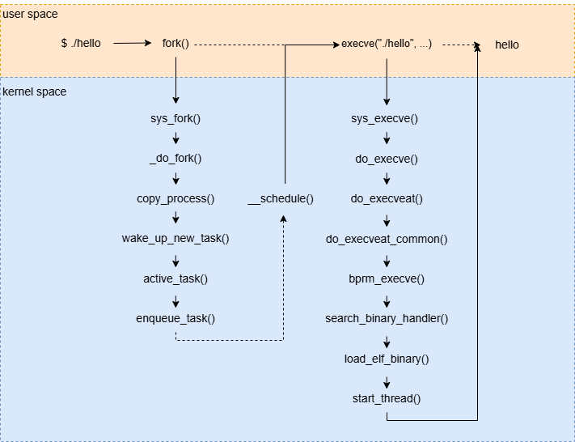
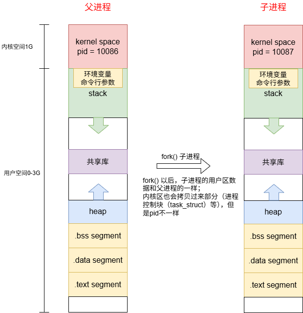
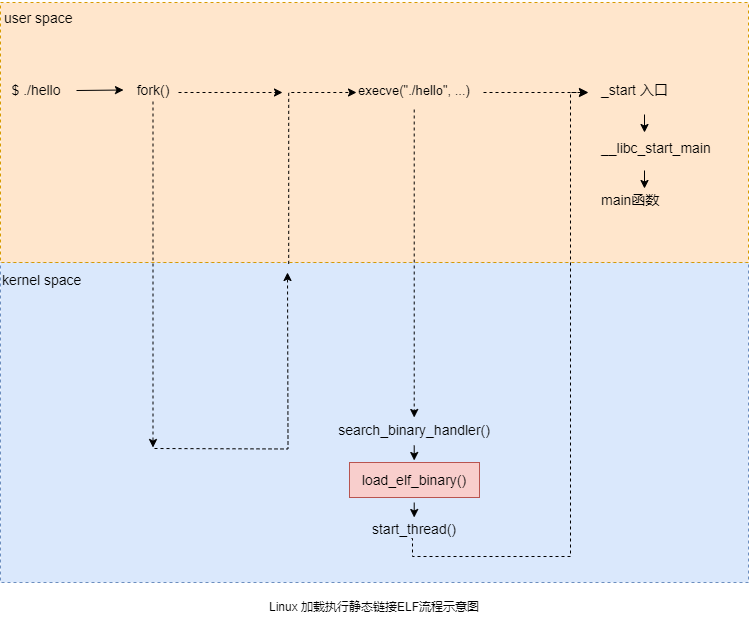
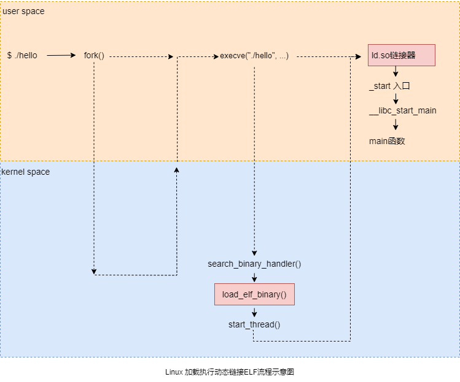

# 基于RISC-V的编译链接和装载11之动态ELF装载

[TOC]

这一章以linux执行`./hello`为例，来跟踪linux执行ELF的过程，下图来自参考1。

Linux环境既支持静态链接ELF加载执行，也支持动态链接ELF加载执行。静态ELF与动态ELF的Linux加载流程是基本是一致的，只在少数地方有差异，文中会重点讨论。




静态链接ELF与动态链接ELF对环境的需求：

1. 静态链接ELF可以在裸机环境或者Linux环境装载以及执行
2. 动态链接ELF一般需要操作系统的支持，因为需要动态链接器以及MMU等支持


## 1 Linux环境装载ELF的整体流程

在用户层面，linux执行`./hello`时，bash进程会调用`fork()`系统调用创建一个新的进程，然后新的进程会调用`execve()` 系统调用执行指定的ELF文件，原来的bash进程继续返回，等待刚才启动的新进程结束，然后继续等待用户输入命令。

linux中程序执行的标准流程为：进程创建（fork）+ 程序替换（execve）两步：

* **进程创建（fork）**：复制进程，为新程序创建独立的执行容器（子进程），并保留父进程的运行环境；
* **程序替换（execve）**：把新程序的代码及数据装进这个容器，替换进程的代码及数据，让容器执行新程序；

进程通常通过fork系统调用来创造一个新的进程，新的进程通过execve()函数创建新的地址空间，并载入新的程序。

作为对比：Windows 没有 `fork+execve` 分阶段的设计，而是通过 `CreateProcess()` 函数一次性完成 “进程创建 + 程序加载”的步骤

### 1.1 第1阶段：fork() 创建子进程

父进程fork子进程的示意图如下图所示（暂不考虑写时复制COW机制）：



**具体步骤为：**

当终端输入 `./hello` 并回车时，当前 Shell 进程（如 bash）会先调用 `fork()` 系统调用，核心流程如下：

1. 用户态调用 `fork()`：

   Shell 进程执行 `fork()` 函数，触发从用户态到内核态的切换；

2. 内核态进入 `sys_fork()`：

   `fork()` 对应的内核系统调用入口是 `sys_fork()`，它是内核处理进程创建的顶层入口；

3. Linux 内核中进程创建的核心函数 `_do_fork()`；

4. 复制进程上下文 `copy_process()`：

   `_do_fork()` 调用 `copy_process()`，复制父进程（Shell）的几乎所有资源：进程控制块（`task_struct`）、内存地址空间（`mm_struct`）、文件描述符、信号处理等；

   **注意：**更准确的说，这里并没有立即复制，这就是 “写时复制（COW）”机制，即子进程暂时共享父进程的内存页，只有当某一方修改内存时才真正复制，避免冗余开销；

5. 激活新进程并加入调度队列：

   `copy_process()` 完成后，调用 `wake_up_new_task()` 唤醒新创建的子进程；接着通过 `active_task()` 标记进程为 “活跃”，再通过 `enqueue_task()` 将子进程加入 CPU 调度队列，等待调度执行；

6. 进程调度 `__schedule()`：

   内核触发调度器 `__schedule()`，决定父进程（Shell）和子进程的执行顺序（通常父进程先继续运行，子进程进入就绪态）；

7. `fork ()` 结果返回：

   父进程（Shell）获得子进程的 PID，子进程返回 0，父子进程从此独立运行。


### 1.2 第2阶段：子进程调用 execve() 装载 hello 程序

子进程接下来会调用 `execve("./hello", ...)`，目的是丢弃原有的代码 / 数据段，加载并执行 `hello` 程序，核心流程如下：

1. 用户态调用 `execve()`：

   子进程执行 execve("./hello", argv, envp)，传入程序路径、参数、环境变量，再次进入内核态；

2. 内核态进入 `sys_execve()`：

   execve()对应的系统调用入口是 sys_execve()；

3. 核心替换逻辑 `do_execve()`：

   sys_execve() 调用 do_execve()，负责解析程序路径、准备执行环境；

4. 路径与文件处理 `do_execveat()`/`do_execveat_common()`：
   - do_execve() 调用 do_execveat()（处理路径相关的细节，如相对路径 / 绝对路径）；
   - 再进入 do_execveat_common()，打开 `./hello` 文件，读取文件头部，准备后续解析；

5. 匹配可执行文件处理器 `search_binary_handler()`：

   内核遍历已注册的可执行文件格式处理器（如 ELF、script、a.out），根据 `hello` 的文件头（ELF 魔数 `0x7f 45 4c 46`）匹配到 ELF 处理模块；

6. 加载 ELF 文件 `load_elf_binary()`：

   这是加载的核心函数，其核心目标是：销毁子进程原有地址空间，解析 ELF 文件并将其映射到进程地址空间，最终设置程序执行入口。

7. 启动新程序 `start_thread()`：

   `load_elf_binary()` 完成后，调用 `start_thread()`，修改子进程的内核栈和寄存器（如将 PC 寄存器设置为 `hello` 的入口地址：ELF 的 `entry` 或动态链接器入口），这一步的本质是：让 CPU 下次调度到该进程时，直接执行 `hello` 程序的第一条指令，而非原来的 Shell 代码。


### 1.3 第3阶段：`hello` 程序实际运行

当内核调度器再次选中该子进程时，CPU 从 `start_thread()` 设置的入口地址开始执行：

1. 如果是静态链接的 `hello`：直接执行 `.text` 段的主函数入口（如 `main()`）；
2. 如果是动态链接的 `hello`：先执行动态链接器（`ld-linux.so`），完成共享库的加载和重定位，再跳转到 `main()`；
3. `hello` 程序执行自身逻辑（如打印 “Hello World”），执行完成后调用 `exit()`，内核回收进程资源。


## 2 execve() 函数的执行细节

本系列主要关注程序的装载与执行流程，所以这里先不关心进程fork流程，重点关注execve函数的执行流程：

 execve() 函数的执行流程如下所示：

~~~c
用户程序调用 execve()
        ↓
系统调用入口 (syscall)
        ↓
sys_execve()                 // 系统调用定义（通常为 wrapper）
        ↓
__do_execve()                // 架构无关层
        ↓
do_execve()                  // 主逻辑入口
        ↓
do_execveat()                // 支持相对路径（at 系列调用）
        ↓
do_execveat_common()
        ↓
bprm_execve()                // binprm 执行主函数
        ↓
search_binary_handler()      // 关键：搜索二进制处理程序（如 ELF、script）
        ↓
load_elf_binary()            // 关键：加载 ELF 可执行文件（常见）
        ↓
start_thread()               // 设置新程序入口（PC = entry point）
~~~


### 2.1 search_binary_handler函数细节

Linux 内核的 `binfmt`（binary format）子系统是 “可执行文件加载的总入口”：当调用 `execve()` 执行一个文件时，会调用`search_binary_handler`函数遍历已注册的 `binfmt` 模块，匹配文件的 “魔数”（文件开头的特征字节），然后调用对应模块的加载逻辑，完成程序映射和启动。

简单来说：search_binary_handler会轮询所有注册过的文件格式（如：elf, a.out, flat, script等），调用适合的加载器/解释器。

**binfmt_elf.c：标准 ELF 格式加载器**：

Linux 最主流的可执行文件格式（包括可执行程序、共享库 `.so`、内核模块 `.ko`、目标文件 `.o` 等）。

~~~c
/* elf 文件加载器，见binfmt_elf.c */

static struct linux_binfmt elf_format = {
	.module		= THIS_MODULE,
	.load_binary	= load_elf_binary,
#ifdef CONFIG_COREDUMP
	.core_dump	= elf_core_dump,
	.min_coredump	= ELF_EXEC_PAGESIZE,
#endif
};
~~~


其他支持的格式如下(可以查阅linux kernel源码)：

| 文件                | 对应格式            | 核心特点                       | 主要场景                                                     |
| ------------------- | ------------------- | ------------------------------ | ------------------------------------------------------------ |
| binfmt_elf.c        | 标准 ELF            | 主流、支持 MMU、动态链接       | 桌面 / 服务器 Linux、有 MMU 嵌入式                           |
| binfmt_elf_fdpic.c  | ELF-FDPIC           | ELF 变体、无 MMU 适配          | 无 MMU 嵌入式 Linux                                          |
| binfmt_elf_fdunit.c | ELF-FDPIC（单元化） | FDPIC 补充、单元化加载         | 小众无 MMU 工业控制设备                                      |
| binfmt_flat.c       | FLAT                | 极致轻量化、无 MMU、仅静态链接 | 资源极度受限的嵌入式设备，比 ELF-FDPIC 更简单                |
| binfmt_misc.c       | 自定义格式          | 通用适配层、支持任意格式       | 跨格式执行（如 Java、WINE），不是某一种固定格式，而是内核提供的 “通用适配层”。 |
| binfmt_script.c     | 脚本文件（#! 开头） | 解析 shebang、调用解释器       | Shell/Python/Perl 脚本                                       |

### 2.2 load_elf_binary函数细节

我们聚焦ELF文件的加载：

简单说：`load_elf_binary()` 的核心工作就是**解析 ELF 文件头 → 调用 mmap 系列函数完成内存映射 → 初始化进程地址空间 → 设置程序入口**。

~~~log
load_elf_binary()
  ├── 解析 ELF 文件头（判断是否为合法 ELF）
  ├── 释放原进程的旧地址空间（mmput()）
  ├── 创建新的地址空间（mm_struct）
  ├── 遍历 ELF 程序段（Program Header）
  │   └── 对每个可加载段调用 mmap_region()（内核态 mmap 核心实现）
  │       ├── 映射代码段（PROT_READ|PROT_EXEC）
  │       ├── 映射数据段（PROT_READ|PROT_WRITE）
  │       └── 映射动态链接相关段
  ├── 处理动态链接（如果是动态 ELF，加载 ld-linux.so 并映射）
  ├── 设置程序入口地址（ELF 的 entry 或动态链接器入口）
  └── 调用 start_thread() 切换到新程序的执行上下文
~~~


`load_elf_binary`函数的关键部分为：

- mmap 映射内存（关键）内核调用mmap_region() （内核态 mmap实现），将 ELF 各段映射到子进程的地址空间：
  - 代码段（.text）：映射为只读、可执行，地址固定（如 0x400000）；
  - 数据段（.data）：映射为可读可写，初始化全局 / 静态变量；
  - BSS 段：映射为可读可写，初始化为 0；
  - 动态链接库（如 libc.so）：如果是动态链接的 `hello`，还会通过 `mmap` 映射共享库到进程地址空间；
  - 栈空间：映射栈区，用于存储局部变量、函数调用栈帧；
- 处理动态链接：如果是动态 ELF，加载动态链接器（`ld-linux.so`），并设置其为临时入口；

## 3 ELF的装载细节

### 3.1 静态ELF装载与动态ELF的装载

上述简单的讲解了ELF的装载以及执行流程，静态ELF以及动态ELF的装载以及执行流程大体是相同的，只有少数地方存在差别，

静态ELF与动态ELF的差异：

* 装载阶段集中在 `load_elf_binary` 函数内部对 `PT_INTERP` 段的处理上
* 执行过程中，静态链接ELF：`_start` 直接干活，然后跳到 `main` 函数；动态链接 ELF：先跳到`ld.so` 把舞台搭好（加载库、绑定地址），然后跳到 `_start`，最后跳到 `main` 函数


为了方便表述，重画linux加载执行静态ELF与动态ELF的过程，省略掉`fork()`以及`execve()`的部分流程（前面讲过），重点突出差异部分。

图中标红块表示静态链接与动态链接这几处存在差异。

**Linux 加载执行静态ELF流程：**



**Linux 加载执行动态ELF流程：**





**装载时是怎么区分是静态链接ELF还是动态链接ELF呢？**

装载器（内核）直接读取ELF文件程序头表（Program Header）中是否有 `PT_INTERP`（Interpreters，解释器/动态链接器）段来判断是静态链接还是动态链接ELF。

`PT_INTERP` 段在文件中对应一个很小的、只读的段，在程序头表中记录一个字符串，这个字符串就是“动态链接器”（也称为程序解释器，即 `ld-linux.so`）在文件系统中的绝对路径。

判定过程如下：

| 判定结果 | 程序头表中是否有 `PT_INTERP`？                               | 内核的动作                                                   |
| :------- | :----------------------------------------------------------- | :----------------------------------------------------------- |
| 动态链接 | 有（且内容指向动态链接器路径，如 `/lib/ld-linux-riscv64-lp64d.so.1`） | 1. 加载ELF文件本身 <br />2. 加载 `PT_INTERP` 段指定的动态链接器到内存 <br />3. 不直接跳转到原程序的入口点，而是将控制权交给动态链接器的入口点 <br />4. 动态链接器完成库加载、重定位后，再跳转回原程序入口 |
| 静态链接 | 没有                                                         | 1. 加载ELF文件到内存 <br />2. 直接跳转到程序头表里记录的 `Entry point`（入口地址），开始执行。 |

注意：不能用 `ET_EXEC/DYN` 区分静态/动态，文件类型 `ET_EXEC` 或 `ET_DYN` 只跟是否启用ASLR（地址随机化）有关，跟动态/静态链接没有必然联系。

- 传统静态链接是 `ET_EXEC`，传统动态链接也是 `ET_EXEC`（非PIE）。
- 如果动态链接启用了 PIE（`-pie`），文件类型是 `ET_DYN`。
- 静态链接也可以编译成 PIE（`-static-pie`），文件类型也是 `ET_DYN`，但它没有 `PT_INTERP`。


### 3.2 静态链接ELF的装载细节

Linux环境下，静态链接ELF文件的装载和执行不依赖外部动态链接器。整个流程在内核态完成文件加载和初始设置，然后直接跳转到用户程序入口。

完整流程可分解为以下6个步骤：

* **step1：内核识别静态程序** – 检查ELF类型，确认不包含 `.interp` 段。

* **step2：加载程序段** – 内核根据Program Headers，使用 `mmap` 将所有 `PT_LOAD` 段映射到内存。

* **step3：设置启动栈** – 内核在用户态栈上布局参数、环境变量和辅助向量（auxv）。

* **step4：设置进程入口** – 内核获取 `e_entry`（程序入口地址），准备跳转。

* **step5：跳转到程序入口** – 内核设置寄存器，通过 `eret` 从内核态进入用户态，跳转到 `_start`。

* **step6：程序执行** – `_start` 调用 C 运行时初始化，完成主程序自身的初始化，最后执行 `main` 函数。


下面用伪代码进行详细描述：

**step1 – 内核识别静态程序**  

内核在 `execve` 系统调用中读取ELF头，检查文件类型。静态程序通常为 `ET_EXEC`（固定地址）或 `ET_DYN`（PIE，地址随机化），且没有 `.interp` 段。

```c
// execve系统调用处理
int do_execve(...) {
    // 1. 读取ELF头
    struct elf64_hdr elf_ex;
    kernel_read(fd, &elf_ex, sizeof(elf_ex));
    
    // 2. 检查程序类型
    if (elf_ex.e_type == ET_EXEC || elf_ex.e_type == ET_DYN) {
        // 3. 查找.interp段（静态程序不存在）
        for (每个Program Header) {
            if (phdr->p_type == PT_INTERP) {
                // 静态程序不会进入此分支
                // 存在.interp说明是动态程序，走另一条路径
            }
        }
        // 无.interp段 → 静态程序，直接加载
    }
}
```

**step2 – 加载程序段**  

内核遍历所有 `PT_LOAD` 类型的Program Header，将各段映射到进程地址空间指定的位置。

```c
// 加载静态程序
unsigned long load_elf_binary(struct file *file) {
    // 对于 ET_EXEC：使用固定地址（如 0x400000）
    // 对于 ET_DYN (PIE)：使用随机基址
    load_addr = (elf_ex.e_type == ET_EXEC) ? 0 : arch_mmap_rnd();
    
    for (每个PT_LOAD段) {
        // 映射到 load_addr + p_vaddr
        elf_map(file, load_addr + phdr->p_vaddr, phdr->p_filesz, ...);
    }
    
    // 返回程序入口点 = load_addr + elf_ex.e_entry
    return load_addr + elf_ex.e_entry;
}
```

**step3 – 设置辅助向量（auxv）**  

内核在用户态栈上构建辅助向量。静态程序的auxv与动态链接相比，不包含 `AT_BASE`（因为没有动态链接器）。

```log
高地址
+-----------------+
| 环境变量字符串    |
| 程序参数字符串    |
+-----------------+
| NULL            | <-- envp结束
+-----------------+
| envp[]数组       |
+-----------------+
| NULL            | <-- argv结束
+-----------------+
| argv[]数组       |
+-----------------+
| argc            |
+-----------------+
| 辅助向量(auxv)  |
| AT_NULL=0       |
| AT_PHDR=0x400040| <-- Program Headers地址（固定或随机）
| AT_PHNUM=8      |
| AT_PAGESZ=4096  |
| AT_ENTRY=0x401050| <-- 程序入口
| AT_FLAGS=0      |
| AT_RISCV_ARCH="rv64gc" |
| AT_PLATFORM="riscv"    |
| ...             |
+-----------------+
| 程序名指针        |
+-----------------+
低地址            <-- 初始栈指针(sp)
```

**step4 – 设置进程入口**  

内核从ELF头中读取 `e_entry` 作为程序入口点。对于PIE程序，入口地址需要加上随机基址偏移。

```c
unsigned long entry_addr = load_addr + elf_ex.e_entry;
```

**step5 – 跳转到程序入口**  

内核设置好寄存器后，通过 `eret` 从内核态返回用户态，直接跳转到程序的 `_start` 入口点。

```assembly
# 内核设置的寄存器状态：
# a0 (x10) = argc
# a1 (x11) = argv指针
# a2 (x12) = envp指针
# a3 (x13) = 辅助向量指针
# sp (x2)  = 栈指针
# pc       = _start (程序入口地址)
# ra (x1)  = 0

eret   # 从内核态返回用户态，直接跳转到 _start
```

**step6： 程序执行**

1. 程序入口 `_start`

`_start` 是程序的真正入口点（由链接器脚本定义），通常由 C 运行时库（如 glibc）提供。它负责设置栈帧，并调用 `__libc_start_main`。

```assembly
# RISC-V _start 汇编示例（简化）
_start:
    # 准备调用 __libc_start_main
    la    a0, main               # main函数地址
    mv    a1, a0                 # argc (已在内核中设置)
    mv    a2, a1                 # argv
    mv    a3, a2                 # envp
    la    t0, __libc_csu_init    # init函数
    la    t1, __libc_csu_fini    # fini函数
    li    t2, 0                  # rtld_fini = 0 (静态链接无ld.so)
    call  __libc_start_main
    # __libc_start_main 不应该返回
    ebreak
```

2. C运行时入口 `__libc_start_main`
   `__libc_start_main` 是 glibc 提供的核心启动函数，负责完成以下任务：

~~~c
int __libc_start_main(...) {
    // 1. 初始化TLS（线程局部存储）
    __libc_setup_tls();
    
    // 2. 调用主程序初始化（__libc_csu_init）
    __libc_csu_init(argc, argv, envp);
    
    // 3. 调用用户写的 main 函数
    int result = main(argc, argv, envp);
    
    // 4. 退出
    exit(result);
}
~~~

3. 主程序初始化 `__libc_csu_init`
   `__libc_start_main` 调用 `__libc_csu_init`，`__libc_csu_init` 是 C 启动（C Startup）初始化函数，它负责按顺序执行主程序自身的初始化段：

```c
void __libc_csu_init(int argc, char **argv, char **envp) {
    // 步骤 A: 执行 .preinit_array（预初始化数组）
    // 优先级最高，通常用于早期设置
    for (i = 0; i < preinit_array_count; i++) {
        preinit_array[i] (argc, argv, envp);
    }
    
    // 步骤 B: 调用 _init 函数（传统的 .init 段）
    // 该函数由编译器生成，可能包含早期的构造函数
    _init();
    
    // 步骤 C: 遍历 .init_array（初始化函数数组）
    // 这是大多数 C++ 全局对象构造函数存放的地方
    for (i = 0; i < init_array_count; i++) {
        init_array[i] (argc, argv, envp);
    }
}
```

4. main函数执行

完成所有初始化后，`__libc_start_main` 调用用户写的 `main` 函数。

```c
int main(int argc, char **argv, char **envp) {
    printf("Hello World!\n");
    return 0;
}
```

5. 程序退出
   当 `main` 函数返回后，`__libc_start_main` 会调用 `exit` 函数，依次执行：

- 调用通过 `atexit` 注册的函数
- 调用共享库和主程序的 `.fini` 及 `.fini_array` 析构函数
- 最终通过 `_exit` 系统调用退出进程。


### 3.3 动态链接ELF的装载的细节

动态链接ELF文件的装载和执行比静态链接ELF稍微复杂一些，完整流程可分解为以下11个步骤：

* **step1: 内核识别动态程序** – 检查ELF类型，并读取 `.interp` 段。
*  **step2: 加载动态链接器** – 将 `ld.so` 映射到进程地址空间（随机化地址）。
*  **step3: 设置启动栈** – 内核在用户态栈上布局参数、环境变量和辅助向量（auxv）。
*  **step4: 跳转到动态链接器** – 内核设置寄存器，通过异常返回（`eret`）从内核态进入用户态，将控制权交给动态链接器。
*  **step5: 动态链接器自举** – 动态链接器完成自身的重定位（修复内部数据引用），使其能够正常运行。
*  **step6: 加载主程序和共享库** – 解析依赖关系，使用 `mmap` 将主程序及所有依赖库映射到内存。
*  **step7: 符号解析和重定位** – 处理各类重定位条目（如 `R_RISCV_*` 类型）。
*  **step8: 惰性绑定初始化** – 设置 `.got` 和 `.plt`，为延迟绑定做好准备。
*  **step9: 调用共享库的初始化函数** – 动态链接器遍历依赖树，依次执行每个共享库的 `.init` 和 `.init_array` 段。
*  **step10: 跳转到程序入口** – 动态链接器将控制权转交给程序的 `_start` 入口点。
* **step11: 程序执行** – `_start` 调用 C 运行时初始化，完成主程序自身的初始化，最后执行 `main` 函数。

下面用伪代码进行详细描述：

**step1 – 内核初始加载** 
内核在 `execve` 系统调用中读取ELF头，检查是否为动态链接程序（`ET_DYN`），并从中找到 `.interp` 段，获取动态链接器的路径。

```c
// execve系统调用处理
int do_execve(...) {
    // 1. 读取ELF头
    struct elf64_hdr elf_ex;
    kernel_read(fd, &elf_ex, sizeof(elf_ex));
    
    // 2. 检查是动态链接程序
    if (elf_ex.e_type == ET_DYN) {
        // 3. 查找.interp段（指定动态链接器路径）
        for (每个Program Header) {
            if (phdr->p_type == PT_INTERP) {
                char interpreter[PATH_MAX];
                kernel_read(fd, interpreter, phdr->p_filesz);
                // 通常为 "/lib/ld-linux-riscv64-lp64d.so.1"
            }
        }
    }
}
```

**step2 – 加载动态链接器** 
内核将动态链接器的可执行文件映射到进程的虚拟地址空间，地址通常启用ASLR（地址空间布局随机化）。

```c
// 加载动态链接器
unsigned long load_elf_interp(struct elf64_hdr *interp_elf_ex,
                             struct file *interpreter) {
    // 映射动态链接器到随机地址
    load_addr = arch_mmap_rnd();
    
    for (每个PT_LOAD段) {
        error = elf_map(interpreter, load_addr + phdr->p_vaddr, ...);
    }
    
    // 返回动态链接器的入口点
    return load_addr + interp_elf_ex->e_entry;
}
```

**step3 – 设置辅助向量（auxv）** 
内核在用户态栈上构建辅助向量，用于向动态链接器传递关键信息。RISC-V架构有一些特有的条目（如 `AT_RISCV_ARCH`）。

启动时栈布局（自高地址向低地址）：

```
高地址
+-----------------+
| 环境变量字符串    |
| 程序参数字符串    |
+-----------------+
| NULL            | <-- envp结束
+-----------------+
| envp[]数组      |
+-----------------+
| NULL            | <-- argv结束
+-----------------+
| argv[]数组      |
+-----------------+
| argc            |
+-----------------+
| 辅助向量(auxv)  |
| AT_NULL=0       |
| AT_PHDR=0x1000  |
| AT_PHNUM=7      |
| AT_PAGESZ=4096  |
| AT_BASE=0x3f0000| <-- 动态链接器基址
| AT_ENTRY=0x1050 | <-- 程序真实入口
| AT_FLAGS=0      |
| AT_RISCV_ARCH="rv64gc" |
| AT_PLATFORM="riscv"    |
| ...             |
+-----------------+
| 程序名指针      |
+-----------------+
低地址            <-- 初始栈指针(sp)
```

**step4 – 控制权转交动态链接器** 
内核设置好寄存器后，通过 `eret` 从内核态返回用户态，跳转到动态链接器的入口。

```assembly
# 内核设置的寄存器状态：
# a0 (x10) = argc
# a1 (x11) = argv指针
# a2 (x12) = envp指针
# a3 (x13) = 辅助向量指针
# sp (x2)  = 栈指针
# pc       = 动态链接器入口地址
# ra (x1)  = 0

eret   # 从内核态返回用户态，返回到动态链接器入口_dl_start
```

**step5 – 动态链接器自举** 
动态链接器的入口（如 `_dl_start`）首先进行自举。动态链接器的自举事实上有一些特殊性，因为PLT机制此时尚未完全就绪，自举时动态链接器不能依赖任何外部函数调用，并且动态链接器本身所需要的全局和静态变量的重定位工作由它本身完成。

自举的核心是完成动态链接器自身的重定位，即修复其内部的数据引用（例如 `.got` 中指向自身数据的条目），使得代码能够正确访问自身的数据段和全局变量，这一过程并非“初始化GOT/PLT”。

```c
// 动态链接器入口
void _dl_start(void *arg) {
    // 自举：修复自身的数据引用（重定位自身）
    _dl_boot(arg);
    
    // 后续步骤...
}
```

**step6 – 加载主程序和共享库** 
动态链接器解析主程序的动态段（`DT_NEEDED`），依次递归加载所有依赖的共享库，通过 `mmap` 将它们映射到进程地址空间。

```bash
# 查看程序依赖示例
$ readelf -d dynamic_riscv

Dynamic section at offset 0x1010 contains 25 entries:
  Tag        Type                         Name/Value
 0x0000000000000001 (NEEDED)             Shared library: [libc.so.6]
 0x000000000000000c (INIT)               0x1020
 0x000000000000000d (FINI)               0x11a8
 0x0000000000000019 (INIT_ARRAY)         0x11000
 0x000000000000001b (INIT_ARRAYSZ)       8 (bytes)
 ...
```

**step7 – 符号解析和重定位** 
动态链接器遍历所有重定位表，根据符号表解析符号地址，并修改相应的内存位置。RISC-V常见的重定位类型示例：

```c
switch (reloc_type) {
case R_RISCV_64:        // 64位绝对地址
    *location = symbol_value + addend;
    break;
case R_RISCV_JUMP_SLOT: // PLT跳转（用于函数调用）
    *location = symbol_value;
    break;
case R_RISCV_RELATIVE:  // 相对重定位（基于加载基址）
    *location = load_address + addend;
    break;
case R_RISCV_COPY:      // 拷贝重定位（用于数据）
    memcpy(location, (void*)symbol_value, sym->st_size);
    break;
}
```

**step8 – PLT/GOT 初始化** 
动态链接器为每个需要延迟绑定的函数设置PLT和GOT条目。初始时，GOT条目指向PLT中的一段解析存根（`PLT0`），当函数首次被调用时会触发解析过程。

```assembly
# .plt节（过程链接表）
.PLT0:  # 惰性解析存根
    auipc t3, %pcrel_hi(.got.plt)   # 加载GOT地址
    ld    t1, %pcrel_lo(.PLT0)(t3)  # 加载_dl_runtime_resolve地址
    ld    t0, 8(t3)                 # 加载链接器标识
    jr    t1                        # 跳转到解析函数

# 每个函数的PLT条目
printf@plt:
    auipc t1, %pcrel_hi(.got.plt)
    ld    t0, 16(t1)                # 加载printf的GOT条目（初值指向PLT0）
    jr    t0
```

`.got.plt`布局示例：

```
.got.plt:
[0] _dl_runtime_resolve地址
[1] link_map
[2] add函数地址
[3] printf的实际地址（初始指向PLT0）
[4] puts的实际地址
...
```

**step9 – 调用共享库的初始化函数** 
动态链接器在完成所有重定位后，会遍历依赖树（从叶子节点到根节点），依次调用每个共享库的 `.init` 和 `.init_array` 段中的初始化函数。
这是动态链接器直接执行的，用于完成库自身的全局对象构造等初始化工作。主程序的初始化函数不在这一阶段执行，而是留到步骤11中由程序自身的启动代码完成。

```c
// 动态链接器遍历所有已加载的共享库，执行它们的初始化函数
// 典型实现：glibc中的 _dl_init 函数
void _dl_init(struct link_map *main_map, int argc, char **argv, char **env) {
    // 构建依赖列表，按依赖顺序（先叶子，后根）
    for (i = 0; i < nlist; i++) {
        // 对每个库调用其初始化函数
        call_init(l->l_info[DT_INIT], argc, argv, env);
        call_init_array(l->l_info[DT_INIT_ARRAY], ...);
    }
}
```

**step10 – 跳转到程序入口** 
动态链接器完成所有共享库的初始化后，将控制权转交给主程序的入口点（`_start`）。这个跳转并非直接跳转，而是通过动态链接器内部的 `_dl_start_user` 等辅助函数完成最后的环境设置（如调整栈指针、传递辅助向量），再跳转到 `_start`。

```c
// 动态链接器最后跳转到主程序入口
_dl_start_user(auxv, ...) {
    // 调整栈，传递正确的参数
    // 跳转到主程序的 _start
    goto program_entry;  // 如 0x1050
}
```

**step11 – 程序执行** 

这里步骤与静态链接的步骤几乎一致，所以这里不再赘述。


### 2.2 一个更复杂的ELF加载器

`03_simple_elfloader`用例是一个简单的用户态（userspace）的 RISC-V ELF 加载器，动态链接的 ELF 交给 [ld.so](http://ld.so/) 去完成链接，静态 PIE 则直接跳程序入口。但是ld.so 是怎么工作的？

`05_ld_elfloader`在`03_simple_elfloader`基础上加入了对ld.so功能的模拟，通过研究代码，读者可以更深入的理解链接器ld.so的工作。

这两个用例的关系为：

|                   | 03_simple_elfloader | 05_ld_elfloader                  |
| ----------------- | ------------------- | -------------------------------- |
| Lines             | ~590                | ~1500                            |
| Linking           | delegated to ld.so  | done here                        |
| Symbol resolution | N                   | Y (ELF hash / GNU hash / linear) |
| Relocation        | N                   | Y (RISC-V RELA types)            |
| init/fini arrays  | N                   | Y                                |
| DT_NEEDED deps    | N (ld.so)           | Y (dlopen)                       |
| RV32 support      | Y                   | Y                                |

详细的编译参数见用例中的README：

~~~sh
$ cd riscv-elf-link-load/test/05_ld_elfloader
$ make all        # build RV64  -> build/rv64/
$ make rv32       # build RV32  -> build/rv32/
$ make run        # build + run RV64 tests under qemu
$ make rv32-run   # build + run RV32 tests under qemu
~~~

这个用例支持两种目标：

1. 动态 ELF（`ET_DYN + PT_INTERP`）
2. 静态 PIE（`ET_DYN`，无 `PT_INTERP`）


**参考：**

1. [(65 封私信 / 80 条消息) Linux系统下ELF文件装入与执行过程分析 - 知乎](https://zhuanlan.zhihu.com/p/721963597)
2. [tinyclub/open-c-book: 开源书籍:《C语言编程透视》，配套视频课程《360° 剖析 Linux ELF》已上线，视频讲解更为系统和深入，欢迎订阅：https://www.cctalk.com/m/group/88089283](https://github.com/tinyclub/open-c-book/tree/master)
2. [程序执行流程 - CTF Wiki](https://ctf-wiki.org/executable/elf/running-overview/)


