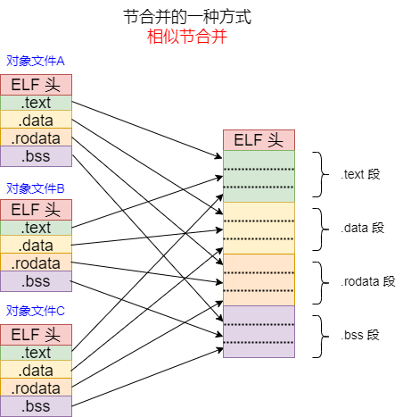

# 基于RISC-V的编译链接和装载12之ld链接脚本

之前写了一篇 《[gcc之ld链接脚本](https://www.cnblogs.com/sureZ-learning/p/17220008.html)》，但是觉得没有写好，有些知识点没有讲完整，所以准备重新写一下链接脚本。

[TOC]

链接脚本（Linker Script）是编译链接过程中的一个“指导手册”。它告诉链接器（如 GNU 的 `ld`）如何将程序各个编译好的目标文件（`.o` 文件）中的段（Section）组合成一个最终的可执行文件，并决定这些代码和数据最终被放置在内存的哪个地址。链接脚本之于链接器（ld），相当于Makefile之于make。

链接脚本的核心职责是建立程序逻辑地址与底层物理地址之间的映射关系。


## 1 链接脚本示例

以《[gcc之ld链接脚本](https://www.cnblogs.com/sureZ-learning/p/17220008.html)》（见参考1）的示例，这是RISC-V平台的链接脚本示例：

链接脚本分为3部分：

* 第一部分： 链接配置
* 第二部分：内存分布定义
* 第三部分：段列表定义

~~~c
/* ======================================== Part1：链接配置 ================================================*/
OUTPUT_FORMAT("elf32-little") /* 定义输出格式 */
OUTPUT_ARCH("riscv")          /* 定义输出架构 */
ENTRY( _start )               /* 程序入口为_start函数，嵌入式工程中常定义在start.s启动文件中 */


/* ======================================== Part2：内存分布定义 ==============================================*/
MEMORY
{
  flash (rxai!w) : ORIGIN = 0x00020000, LENGTH = 4M   
  ilm (rxai!w) : ORIGIN = 0x00080000, LENGTH = 64K
  ram (wxa!ri) : ORIGIN = 0x00090000, LENGTH = 64K
}

/* 可以对内存块的名字起别名，方便使用 */
REGION_ALIAS("ROM", flash)
REGION_ALIAS("RAM", ram)

/* ======================================== Part3：段列表定义 ==============================================*/
SECTIONS
{
   .init           :
  {
    KEEP (*(SORT_NONE(.init))) /* 链接时使用了选项–gc-sections后，链接器可能将某些它认为没用的section过滤掉，
                                * KEEP命令可以强制链接器保留一些特定的section
                                */
  } >ROM AT>flash
 
  .text           :
  {
    *(.text .text.*) /* *(.text) 表示所有输入文件中名字为.text的文件。*是通配符，链接脚本支持正则表达式中的？、[]等规则 
                      * 如：[a-z]*(.text*[A-Z])表示所有输入文件为小写字母a-z开头，所有段名以.text开头，以大写字母A-Z结尾
                      * 的段
                      */
    *(.gnu.linkonce.t.*)
  } >ilm AT>flash
  /* 注意：上述语法中AT前的一个ilm表示该段的运行地址，AT后的flash表示该段的加载地址，意思是让程序段存储在Flash之中，而装载到ILM中运行，
   * 加载地址是该程序的存储地址（调试器下载程序之时会下载到此地址），运行地址却是指程序真正运行起来后所处于的地址。
   */

  .data          :
  {
    *(.rdata)
    *(.rodata .rodata.*)
    *(.data .data.*)
    *(.gnu.linkonce.d.*)
    . = ALIGN(8);                             /* ALIGN 表示字节对齐，需要2的幂 */
    PROVIDE( __global_pointer$ = . + 0x800 ); /* PROVIDE在链接脚本中定义一个标签，相当于全局变量，
                                               * 该符号可以在程序中引用，后续会举例说到
                                               * 赋值语句一定要用; 结尾，其它语句用;或者换行结尾都行
                                               */
    *(.sdata .sdata.* .sdata*)
    *(.gnu.linkonce.s.* )
    . = ALIGN(8);                              /* ‘.’ 表示当前地址，可以作为左值也可作为右值 */
    *(.srodata .srodata.*)
  } >RAM AT>ROM
 
  PROVIDE( __bss_start = . );
  .bss (NOLOAD)   : ALIGN(8)                 /* NOLOAD 表示该section在程序运行时不被载入内存
                                              * 另外，还有四种类型DSECT,COPY,INFO,OVERLAY，很少被使用
                                              */
  {
    *(.sbss*)
    *(.gnu.linkonce.sb.*)
    *(.bss .bss.*)
    *(.gnu.linkonce.b.*)
    *(COMMON)
    . = ALIGN(4);
  } >RAM AT>RAM
  
  PROVIDE( _end = . );
  PROVIDE( end = . );
}
~~~

**注意链接脚本中的几个奇怪语法：**

* section 表示输出段的名字，段名后需要接至少一个空格，这样使得输出段名不会有歧义

* 链接脚本中赋值语句一定要用`; `结尾，其他情况可以一律不加 `;`

* 链接脚本中赋值语句`=` 号两边必须有空格

下面通过这个例子来分析链接脚本的核心作用。

## 2 链接脚本的作用

链接脚本的核心职责之一是建立程序逻辑地址与底层物理地址之间的映射关系。这一过程主要通过两个阶段协同完成：

- 内存分区（Memory Partitioning）：通过 `MEMORY` 命令定义芯片的物理内存分区，划分出多个具有特定属性（如只读、可读写）的存储区域。
- 地址映射（Address Mapping）：通过 `SECTIONS` 命令规划内存布局，将目标文件中的各个节（Section）精确地分配到上述定义的物理区域中，并确定其最终的运行地址与加载地址。

### 2.1 链接配置

~~~c
/* ======================================== Part1：链接配置 ================================================*/
OUTPUT_FORMAT("elf32-little") /* 定义输出格式 */
OUTPUT_ARCH("riscv")          /* 定义输出架构 */
ENTRY( _start )               /* 程序入口为_start函数，嵌入式工程中常定义在start.s启动文件中 */
~~~

其中：

* `OUTPUT_FORMAT`命令定义了输出格式

* `OUTPUT_ARCH`命令定义了输出架构

* `ENTRY`命令指定整个程序入口，一般`_start`是startup.S的第一个lable，这个地址与`riscv64-unknown-linux-gnu-readelf -h xxx.elf` 看到的 Entry point address 字段是一致的，告诉加载器从什么地址开始执行

### 2.2  内存分区

内存分区，也即描述目标硬件的物理内存布局。

可以使用`MEMORY` 命令明确告诉链接器有哪些内存区域可用、区域的起始地址、大小以及读写执行权限。

~~~c
/* ======================================== Part2：内存分布定义 ==============================================*/
MEMORY
{
  flash (rxai!w) : ORIGIN = 0x00020000, LENGTH = 4M   
  ilm (rxai!w) : ORIGIN = 0x00080000, LENGTH = 64K
  ram (wxa!ri) : ORIGIN = 0x00090000, LENGTH = 64K
}
~~~

其中`MEMORY` 命令语法为：

~~~c
MEMORY
{
name [(attr)] : ORIGIN = origin, LENGTH = len
...
}
~~~

name是可以自定义的，只有在这个链接脚本中能用，链接脚本外没有意义

attr的属性如下：

|      |                                                       |
| ---- | ----------------------------------------------------- |
| R    | Read-only section                                     |
| W    | Read/write section                                    |
| X    | Executable section                                    |
| A    | Allocatable section                                   |
| I    | Initialized section                                   |
| L    | Same as ‘I’                                           |
| ！   | Invert the sense of any of the attributes that follow |

**! 属性的问题：**

例子中，ram (wxa!ri) 属性中有w!r字样，很容易引起误解，它意思并不是可写不可读，而是可读可写段。

在` MEMORY` 命令中，(W!R) 是一个“过滤器”，所以其表达的意思是：这个区域可以容纳具有 W（可读写）属性的节，同时拒绝具有 R（只读）属性的节。这个过滤器的实际效果是：

- 放进来的：带有 `W` 属性，且没有 `R` 属性的节。也就是普通的、可读可写的全局变量（`.data`, `.bss`）
- 被拒绝的：带有 `R` 属性的节。也就是只读常量（`.rodata`）

**注意：**在 `MEMORY` 命令中定义的属性（如 `!rw`），并不会阻止在 `SECTIONS` 命令中显式地将段放入该区域。 链接器的底层逻辑是：“开发者既然显式指定了地址，说明开发者知道自己在做什么（比如在做某种特殊的硬件映射）”，因此它不会进行属性冲突检查。其真正作用是“兜底防御”。它专门用来拦截那些忘记写 `> region` 的、游离的输入节


### 2.3 地址映射

通过`MEMORY`命令进行地址分区后，接下来需要建立程序逻辑地址与底层物理地址之间的映射关系。我们一般按照 **节（Section）** 来映射物理地址。另外我们也可以调节节的合并顺序。

#### 2.3.1 SECTIONS命令实现节地址映射

使用`SECTIONS`命令中的 address`/`AT(lma)` 和 `>region`/`AT>lma_region 字段用来进行地址映射。

**SECTIONS语法完整语法如下：**

```c
section [address] [(type)] : [AT(lma)]
{
    input-section-command
    input-section-command
    ...
} [>region] [AT>lma_region] [:phdr :phdr ...] [=fillexp]
```

* `section` 表示输出段的名字，**段名后需要接至少一个空格，这样使得输出段名不会有歧义** （见参考2）；
* `address` 表示这个段的起始地址（VMA），这个参数不是必须的，如果没有指定（同时>region也没有指定），那么就会将该段放置到当前位置计数器指定的位置上；
* `(type)` 表示段的类型，这个参数也是可选的，常见的：
  * NOLOAD 表示该section在程序运行时不被载入内存
  * OVERLAY见第16讲linker overlay
  * 另外还有四种类型 DSECT、COPY、INFO很少被使用
* `AT(lma)` 表示段的加载地址，同样也是可选的。前面提到的“address”指定的是虚拟地址，而这里指定的是实际加载的地址。如果不指定的话，那么加载地址被默认设置成虚拟地址；
* `>region`表示将这个段的运行地址（VMA）；
* `AT>lma_region`表示这个段的加载地址（LMA）；
* `=fillexp`是一个表达式，表示输出节区所有未指定的区域都使用这个表达式的值来填充。
* `input-section-command`指明哪些输入文件的哪些段要合并输出到当前段中。


**input-section-command举例：**

input-section-command的条件写法如下：

```c
input-file(section)
```

- `input-file` 表示输入文件名
- `section` 表示输入段名

举例如下：

1. `file1.o(.data)`，表示输入文件 `file1.o` 中名为 `.data` 的段符合条件。
2. `file1.o(.data .rodata)` 或 `file1.o(.data, .rodata)`，表示输入文件 `file1.o` 中名为 `.data` 或 `.rodata` 的段符合条件。
3. `file1.o`，如果直接指定文件名而省略后面的小括号和段名，则表示 `file1.o` 的**所有段**都符合条件。
4. `*(.data)`，表示所有输入文件中名字为 `.data` 的段符合条件，`*` 是通配符。


**LMA（加载地址）与 VMA（运行地址）：**

LMA（加载地址）与VMA（运行地址）的解释如下：

* VMA: virtual memory address. This is the address the section will have when the output file is run
* LMA: load memory address. This is the address at which the section will be loaded

大部分时候LMA（加载地址）与VMA（运行地址）都是相同的，程序都是先加载，后运行；

但有些嵌入式系统中先都将代码和数据加载到了ROM中，当开始运行之后，需要将数据部分拷贝到RAM中，数据拷贝工作也常在start.s 中完成搬运工作。此时ROM地址为LMA，RAM地址为VMA

当我们设置了LMA与VMA，ELF到底发生了什么变化？

~~~~log
$ riscv64-unknown-linux-gnu-readelf -lW helloworld.elf

Elf file type is EXEC (Executable file)
Entry point 0x10468
There are 10 program headers, starting at offset 64

Program Headers:
  Type           Offset   VirtAddr           PhysAddr           FileSiz  MemSiz   Flg Align
  PHDR           0x000040 0x0000000000010040 0x0000000000010040 0x000230 0x000230 R   0x8
  INTERP         0x000270 0x0000000000010270 0x0000000000010270 0x000021 0x000021 R   0x1
      [Requesting program interpreter: /lib/ld-linux-riscv64-lp64d.so.1]
  RISCV_ATTRIBUT 0x001045 0x0000000000000000 0x0000000000000000 0x0000ca 0x000000 R   0x1
  LOAD           0x000000 0x0000000000010000 0x0000000000010000 0x0005c0 0x0005c0 R E 0x1000
  LOAD           0x000df0 0x0000000000011df0 0x0000000000011df0 0x000228 0x000230 RW  0x1000
  DYNAMIC        0x000e08 0x0000000000011e08 0x0000000000011e08 0x0001e0 0x0001e0 RW  0x8
  NOTE           0x0005a0 0x00000000000105a0 0x00000000000105a0 0x000020 0x000020 R   0x4
  GNU_EH_FRAME   0x000518 0x0000000000010518 0x0000000000010518 0x000024 0x000024 R   0x4
  GNU_STACK      0x000000 0x0000000000000000 0x0000000000000000 0x000000 0x000000 RW  0x10
  GNU_RELRO      0x000df0 0x0000000000011df0 0x0000000000011df0 0x000210 0x000210 R   0x1
~~~~

其中的VirtAddr 与 PhysAddr 就是对应着LMA与VMA

在链接器脚本（ld script）中，`LOADADDR` 和 `ADDR` 是两个不同的内置函数或关键字，它们用于获取特定输出段的不同类型的地址信息：

* `ADDR(section)` 提供的是段的**运行时地址**（即 VMA），这是程序实际执行时段所在的内存地址。

* `LOADADDR(section)` 提供的是段的**加载地址**（即 LMA），这是段在存储介质上的地址，通常用于描述段最初被加载的位置。

  

**address`/`AT(lma)` 和 `>region`/`AT>lma_region：**

`address`/`AT(lma)` 和 `>region`/`AT>lma_region` 用于配置相同类型的地址，但它们代表的不是“功能重复”，而是链接脚本中一种精巧的设计：为同一概念提供了“绝对指定”和“相对/自动分配”两种不同的表达方式，以满足不同场景下的精确控制与灵活布局需求。

- `address` 和 `>region` 互斥（不能同时指定 VMA）。
- `AT(lma)` 和 `AT>lma_region` 互斥（不能同时指定 LMA）。

* 但VMA 的配置方式与 LMA 的配置方式是可以自由组合的

这说明VMA与LMA只能是唯一确定的。

区别如下：

| 功能类别                | 绝对指定方式                                                 | 区域/自动分配方式                                            |
| :---------------------- | :----------------------------------------------------------- | :----------------------------------------------------------- |
| **设置VMA（运行地址）** | `address`：直接指定一个精确的数值作为VMA。                   | `>region`：将VMA分配到预先用`MEMORY`命令定义的内存区域中，地址由链接器根据区域当前位置自动计算。 |
| **设置LMA（加载地址）** | `AT(lma)`：直接指定一个精确的数值作为LMA。                   | `AT>lma_region`：将LMA分配到一个内存区域中，地址由链接器自动计算。 |
| **核心特点**            | **精确控制**：开发者完全掌控地址，常用于有严格地址要求的场景，如中断向量表。 | **自动布局**：将地址计算交给链接器，简化脚本编写并提高代码对内存布局变更的适应性。 |

#### 2.3.2 控制节的合并顺序

第7讲中讲述静态链接与动态链接，提到了节合并，意思是将多个目标文件中相同类型的节（section）合并成一个连续的节（相似节合并）。



我们可以使用**链接脚本**指定节的组装顺序，具体来说可以控制如下顺序：

1. 控制最终输出节（Output Sections）的先后顺序
2. 控制不同源文件（目标文件）的节合并顺序
3. 控制同一源文件内部符号/节的先后顺序（需编译器参与）

具体示例见第7讲。

## 3 链接脚本的其它作用

### 3.1 符号导出

链接脚本可以定义绝对地址符号，C代码通过 `extern` 声明即可使用。

例如： bss段定义了`__bss_start` 与 `_end` 两个地址符号。

~~~ld
  PROVIDE( __bss_start = . );
  .bss (NOLOAD)   : ALIGN(8)                 /* NOLOAD 表示该section在程序运行时不被载入内存
                                              * 另外，还有四种类型DSECT,COPY,INFO,OVERLAY，很少被使用
                                              */
  {
    *(.sbss*)
    *(.gnu.linkonce.sb.*)
    *(.bss .bss.*)
    *(.gnu.linkonce.b.*)
    *(COMMON)
    . = ALIGN(4);
  } >RAM AT>RAM
  
  PROVIDE( _end = . );
  PROVIDE( end = . );
~~~

然后在启动脚本`Startup.S`中将bss段清0：

~~~c
    /* Clear bss section */
    la a0, __bss_start
    la a1, _end
    bgeu a0, a1, 2f
1:
    sw zero, (a0)
    addi a0, a0, 4
    bltu a0, a1, 1b
2:
~~~


**注意：**链接脚本中的直接赋值（强符号）优先级高于C代码中的任何数据对象定义，链接脚本中可以使用`PROVIDE`关键字来修饰符号，`PROVIDE` 关键字的作用，本质上就是在链接脚本中为符号添加了 `WEAK`（弱）属性，使得它可以在被 C 代码中的强符号覆盖时“让位”。


### 3.2 丢弃不需要的节：`/DISCARD/`

`/DISCARD/`用于剔除调试信息、注释段等无用内容，缩小固件体积。

~~~ld
SECTIONS
{
    /* 丢弃所有调试信息 */
    /DISCARD/ : 
    {
        *(.debug_*)
        *(.comment)
        *(.note)
        *(.ARM.attributes)
    }
}
~~~

**`/DISCARD/` 与 `-s, --strip-all`选项的区别： ** 

ld链接时，使用`-s, --strip-all` 确实可以移除调试信息，但 `/DISCARD/` 和 `strip` 的作用层面、时机和效果都有本质区别。

| 维度              | `/DISCARD/`                                         | `-s, --strip-all`                                            |
| ----------------- | --------------------------------------------------- | ------------------------------------------------------------ |
| 作用阶段          | 链接布局阶段（生成 ELF 之前，源头拦截）             | 链接完成之后（生成 ELF 之后，事后剥离）                      |
| 作用对象          | 输入节（如 `.debug_*`, `.comment`，不用的代码段等） | ELF 结构（符号表、调试段、节头表），<br />只移除调试/符号，不能移除代码段等 |
| 能否移除符号表    | 不能（符号表是链接器生成的）                        | 能（这是它的主要功能）                                       |
| 灵活性            | 高，可精确指定丢弃哪些节                            | 低，属于全局性的“一刀切”                                     |
| 对 ELF 结构的破坏 | 无，正常生成结构，只是少了几个段                    | 强，会修改或清空节头表等元数据                               |
| 适用场景          | 发布版固件、精简工程                                | 减小调试文件体积                                             |

### 3.3 节属性控制：`NOLOAD`

bss段设置了NOLOAD属性，如下，这个属性有什么用呢？

~~~ld
  PROVIDE( __bss_start = . );
  .bss (NOLOAD)   : ALIGN(8)                 /* NOLOAD 表示该section在程序运行时不被载入内存
                                              * 另外，还有四种类型DSECT,COPY,INFO,OVERLAY，很少被使用
                                              */
~~~

**`NOLOAD`：预留内存空间**

`NOLOAD` 是最常用、最实用的一个属性。含义是：链接器会为这个节在内存区域（如RAM）中分配地址和空间，但是这个节的内容（即“0”和“1”的初始数据）不会被放进最终烧录到Flash的`.bin`或`.hex`文件里。

**典型应用：**用于声明共享内存、堆（Heap） 或栈（Stack） 等运行时才需要的内存区域。这些区域在启动时并不需要从Flash加载初始值，只需要一个干净的地址空间即可。使用 `NOLOAD` 可以显著减小固件文件的大小。


**参考：**

1. [gcc之ld链接脚本 - sureZ_ok - 博客园](https://www.cnblogs.com/sureZ-learning/p/17220008.html)
2. https://sourceware.org/binutils/docs/ld/
3. [gcc链接脚本ld 实例讲解 - solonj - 博客园](https://www.cnblogs.com/solo666/p/16639842.html)

