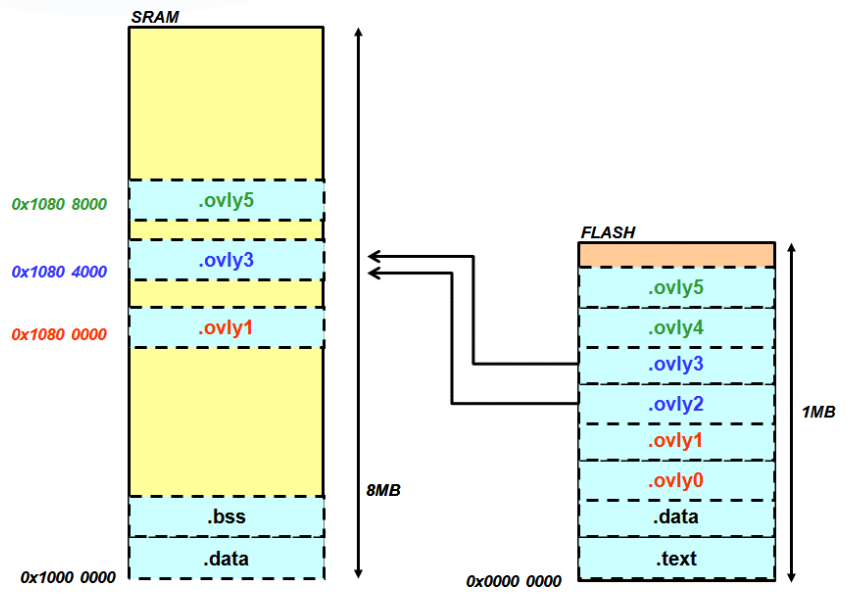

# 基于RISC-V的编译链接和装载16之linker overlay

Linker Overlay 是一种在内存受限系统（如嵌入式 MCU裸机）中，让多个函数或数据段共享同一块物理内存区域（RAM）的技术，运行时需要开发者手动划分 Overlay 区域，手动调用管理函数。

**注意：**Linker Overlay 在MMU出来之前使用比较广泛，现在几乎已经淘汰，在没有MMU的嵌入式场景有一些用武之地，由于Linux 拥有 Swap（交换分区/文件） 和 虚拟内存管理（MMU），所以linux不需要Linker Overlay 技术，下面的介绍都是针对MCU裸机场景。

## 1 linker overlay 简单介绍

### 1.1 为什么嵌入式 MCU需要 Overlay？

考虑一个场景，嵌入式MCU中，程序比较大，Flash 足够大可以放整个程序，但 SRAM 不足（Flash分普通模式与XIP模式，普通模式不能执行代码，XIP模式可以执行代码但速度很慢），这个时候我们可以考虑使用分时复用RAM技术，也即linker overlay技术。

下图来源于参考1。

### 1.2 Overlay 的关键机制：VMA vs LMA

linker overlay的核心是：

* 不同模块的 LMA 不同（它们在 Flash 中各自位置）
* VMA 相同（它们都“认为”自己运行在同一个 RAM 区域）

或者这么表述：

Linker Overlay 就是利用 VMA/LMA 分离，让多个模块“假装”都在同一地址运行，实际由软件分时加载，从而节省宝贵内存。

| 缩写    | 名称                   | 含义                                             |
| ------- | ---------------------- | ------------------------------------------------ |
| **LMA** | Load Memory Address    | 段在可执行文件中的加载地址（存储位置，如 Flash） |
| **VMA** | Virtual Memory Address | 段运行时的虚拟地址（程序访问的地址，如 RAM）     |

下图来自于参考4，表示：.ovly0 与 .ovly1 共一个VMA，.ovly2与.ovly3共一个VMA， .ovly4与.ovly5共一个VMA。

表示：程序执行时，0x10800000可以加载.ovly0或是.ovly1。0x10804000可以加载.ovly2或是.ovly3。0x10808000可以加载.ovly4或是.ovly5。

### 1.3 两种 Overlay 实现方式

我们需要区分两种不同复杂度的 Overlay 实现：

**基础 Overlay (Manual Overlay)**

实现方式：依赖链接器脚本（`.ld` 文件）中的 `OVERLAY` 命令来组织代码布局，但运行时的加载和切换完全由开发者手动编码控制。

在这种模式下，开发者必须通过精心设计程序流程，如果A块与B块共享（或重叠）同一块 RAM 区域，那么A块与B块不能发生跨块调用，否则会失败（除非A块B块加载到RAM的不同位置，但这就失去overlay的意义）。开发者需要编写一个小的辅助代码来管理这些模块何时驻留内存而何时应该被替换掉，这个辅助代码就是所谓的覆盖管理器（Overlay Manager），可以参考《程序员的自我修养》6.2.1 覆盖装入这一节。

**高级 Overlay (Automatic/Stub-based Overlay)**

实现方式：这是[《riscv overlay》 ](https://github.com/riscv-software-src/riscv-overlay/)正在推进的 “**Stub + RT-Engine**”方案。它需要编译器、链接器和运行时库的深度协同。编译器为跨块调用生成特殊的“stub”代码，链接器创建映射表，RT-Engine根据存根的请求来自动加载代码块（RT-Engine 本质上是一个用户态的微型装载器）。也即把手动加载改为RT-Engine加载。

## 2 linker overlay示例

目前 “**Stub + RT-Engine**”方案还没有十分成熟，所以这里以`sifive/riscv-overlay-example` 为例讲述基础overlay的实现，这种场景，需手动管理overlay，开发者需要在代码中显式地调用加载函数，将不同的 Overlay 块手动加载到共享的 RAM 区域。

**step1： 编写链接脚本**

Overlay功能的实现，最关键的一步是编写链接器脚本（`.ld`文件）

~~~c
/* 定义共享内存区域：在MEMORY命令中，需要明确定义一个Overlay区域，它通常是一块SRAM */
MEMORY
{
  ram          : ORIGIN = 0x0, LENGTH = 120K
  overlay_code : ORIGIN = 0x0001e000, LENGTH = 1K
  overlay_data : ORIGIN = 0x00021000, LENGTH = 1K
  rom          : ORIGIN = 0x00022000, LENGTH = 1K
}
SECTIONS
{
 /* 使用OVERLAY命令：在SECTIONS命令中，使用OVERLAY语法将所有需要分时复用的目标文件（.o）或库文件放置进来 */
  /* text overlay */
  code_base = ORIGIN(overlay_code);
  OVERLAY : NOCROSSREFS
  {
    .code_func1 { func1.o(.text) }
    .code_func2 { func2.o(.text) }
    .code_foo { foo.o(.text) }
  } >overlay_code AT>rom

  /* Data overlay */
  data_base = .;
  OVERLAY : NOCROSSREFS
  {
    .data_func1 { func1.o(.data .sdata) }
    .data_func2 { func2.o(.data .sdata) }
    .data_foo { foo.o(.data .sdata) }
  } >overlay_data AT>rom
 }
~~~

这段链接器脚本指示链接器：

1. `.code_func1`,`.code_func2`和 `code_foo` 节在Flash中会被连续存放（LMA连续）但运行地址（VMA）被强制设为相同

2. 生成符号表：链接器会为每个Overlay模块生成特殊的加载地址（LMA）和运行地址（VMA）符号，这些符号将用于后续的手动加载过程。

**step2： 手动加载与切换**

完成链接脚本配置后，运行时的加载和切换完全由开发者手动编码控制。开发者需要编写一个自定义函数（例如 `load_overlay()`），其核心功能是利用链接器生成的符号，通过`memcpy`或类似操作，从Flash（LMA）将指定Overlay块的数据拷贝到共享的RAM区域（VMA）。

~~~c
/* Defined automatically with OVERLAY keyword in linker script. 
 * Doc: https://sourceware.org/binutils/docs/ld.html#Overlay-Description
 * */
extern void *__load_start_code_func1;
extern void *__load_stop_code_func1;
extern void *__load_start_data_func1;
extern void *__load_stop_data_func1;

extern void *__load_start_code_func2;
extern void *__load_stop_code_func2;
extern void *__load_start_data_func2;
extern void *__load_stop_data_func2;

extern void *__load_start_code_foo;
extern void *__load_stop_code_foo;
extern void *__load_start_data_foo;
extern void *__load_stop_data_foo;

/* Handy macro to load overlay.
 *   vma: the start address to load code/data to.
 *   overlay: an overlay section defined in linker script.

     For example, for the overlay section declarared as follows:
     OVERLAY : NOCROSSREFS
     {
       .code_func1 { func1.o(.text) }
       .code_func2 { func2.o(.text) }
       .code_foo { foo.o(.text) }
     } >overlay_code AT>rom

     the 'overlay' for this macro can be 'code_func1', 'code_func2' or 'code_foo'.
 */
#define LOAD_OVERLAY(vma, overlay) \
    printf("  Loading section %s\n", #overlay); \
    printf("    Load from: %p\n", &__load_start_##overlay); \
    printf("    Load to: %p\n", &vma); \
    printf("    length: %ld bytes\n", &__load_stop_##overlay - &__load_start_##overlay); \
    memcpy(&vma, \
           &__load_start_##overlay, \
           &__load_stop_##overlay - &__load_start_##overlay);
~~~

为了方便使用，可以封装一个函数：

~~~c
void load_overlay(int n)
{
    /* Record for current overlay */
    static int current_overlay = 0;

    if (n == current_overlay)
    {
        printf("Overlay %d already loaded.\n", n);
        return;
    }

    /* Load the corresponding overlay */
    printf("Loading overlay %d...\n", n);
    switch (n) {
      case 1:
        LOAD_OVERLAY(code_base, code_func1);
        LOAD_OVERLAY(data_base, data_func1);
        break;

      case 2:
        LOAD_OVERLAY(code_base, code_func2);
        LOAD_OVERLAY(data_base, data_func2);
        break;

      case 3:
        LOAD_OVERLAY(code_base, code_foo);
        LOAD_OVERLAY(code_base, data_foo);
        break;

      default:
        printf("Error - invalid overlay number %d specified\n", n);
        exit(1);
        break;    
    }

    /* update record of current overlay */
    current_overlay=n;

    printf("...Done.\n");
}
~~~

**step3：main函数主动调用切换**

在应用程序的逻辑中，当需要执行某个功能时，必须先调用上述加载函数，将对应的Overlay块加载到RAM中，然后才能调用该块中的函数

~~~c
/* Functions provided by the overlays */
extern "C" {
  extern void func1(void);
  extern void func2(void);
}

int main(void)
{
    printf("Start of main()...\n");
    func1();
    func2();

    /*
     * Call func2() again to demonstrate that we don't need to
     * reload the overlay
     */
    func2();

    func1();

    Foo myfoo;
    printf("%s\n", myfoo.foo());
    printf("%s\n", myfoo.bar());

    Bar mybar;
    printf("%s\n", mybar.foo());
    printf("%s\n", mybar.bar());

    printf("End of main()...\n");

    return 0;
}
~~~

通过该示例可以清晰看到，基础Overlay模式存在很强的约束：

- 无跨块调用：处于同一Overlay区域的不同块（如`块0`与`块1`）中的函数，绝对不能互相调用。因为在调用时，当前RAM中只驻留了一个块，调用另一个块的函数会导致程序跳转到一个未被加载的地址，从而引发硬件异常。
- 调用开销：每次切换都需要执行一次`memcpy`，这会带来额外的CPU时间开销，因此这种技术更适用于状态机模式（即大段代码一次性加载，并持续运行一段时间）的程序，而非频繁切换的场景。

**参考：**

1. https://github.com/riscv-software-src/riscv-overlay/

1. https://github.com/sifive/riscv-overlay-example/
2. https://sourceware.org/gdb/current/onlinedocs/gdb.html/Overlay-Sample-Program.html
3. https://www.andestech.com/cn/2013/12/11/%E8%BD%AF%E4%BB%B6overlay%EF%BC%9A%E7%A8%8B%E5%BA%8F%E7%BC%96%E5%86%99%E4%B8%8E%E8%B0%83%E8%AF%95-2/